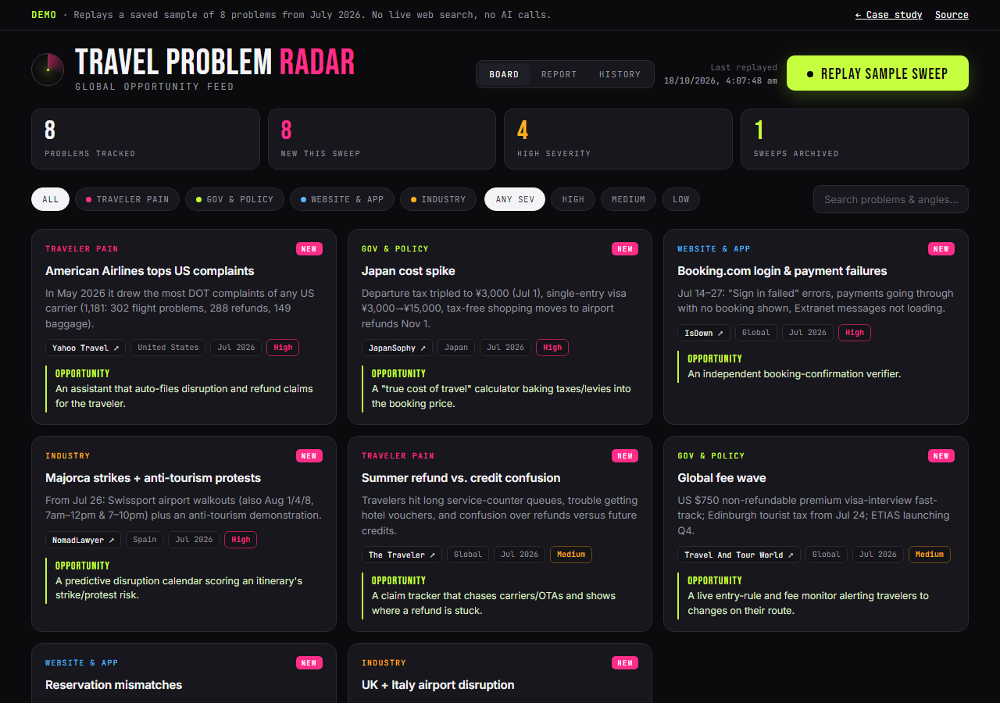
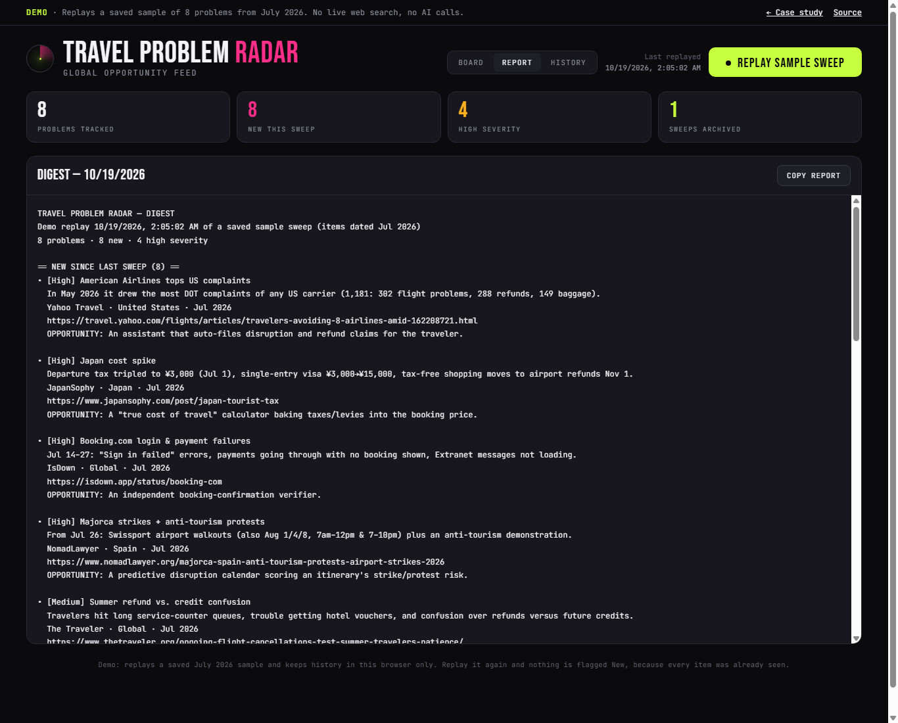

# Travel Problem Radar: travel-industry problems, each turned into a product idea

*Above: the public demo after replaying the July 2026 sample. Every card has a source link and a one-line product
opportunity.*

Travel Problem Radar searches the web for problems in travel: traveler complaints, new visa rules and taxes,
booking-site outages, strikes. It sorts what it finds into four categories, flags anything not seen before, and tags
each item with a product idea a PM could build.

**Product owner:** Bhawna Mangla · **Built with AI** (Claude) · **Status:** prototype, first built July 2026

| | |
|---|---|
| **Case study** | https://bhawnamanglapm.github.io/travel-problem-radar-case-study/ |
| **Try the demo** | https://bhawnamanglapm.github.io/travel-problem-radar-case-study/demo/ (replays a saved sample; no AI calls) |
| **Sample digest** | https://bhawnamanglapm.github.io/travel-problem-radar-case-study/demo/#report |
| **Live page** | https://travel-problem-radar.vercel.app/live/. Deployed; a sweep runs every 5 hours. The first production sweep (Oct 2026) saved items from only 1 of 4 categories; the cause, an output token limit, is fixed and a local run returned all four. |
| **More** | [Technical reference](docs/TECHNICAL.md) · [PRD](docs/PRD.md) · [Decision log](docs/decisions.md) · [Changelog](CHANGELOG.md) |

---

## Problem

The case study puts it this way: *"The best product ideas in travel start as someone's bad day: a refund that never
came, a visa fee that quietly quadrupled, a booking that vanished after payment. But those signals live everywhere:
news wires, government notices, outage trackers, review sites, protest calendars. No PM has time to read all of it,
every day, across the world."*

The user is a product manager looking for problems worth solving, starting with the owner. The goal is a standing
feed that finds problems, sorts them and suggests the "so what" before the morning starts, rather than a one-off
research report.

> **OWNER INPUT NEEDED:** did anyone other than you use the radar (a PM team, a manager)? If not, say so. This repo
> records no user research.

## Why AI, and why not just rules

The repo does not record whether keyword alerts or RSS feeds were tried first. This is how the design splits the work
between the model and plain code:

| Job | Who does it | Why |
|---|---|---|
| Finding problems across news, government notices, outage trackers and travel sites, worldwide | Claude with its web-search tool, one call per category | There is no fixed list of sources or keywords. A model can search, read and judge relevance across countries and formats. |
| Writing a summary, judging severity, proposing a product opportunity | Claude, in a fixed JSON shape | This is the judgement part: turning a news item into a product angle. |
| Merging, de-duplicating, flagging "New", keeping history, limiting runs | **Plain code** | These must be predictable and testable. All of them are covered by offline tests. |
| Cleaning the model's output | **Plain code** | A link must start with `http(s)://` or it is dropped; severity outside Low/Medium/High becomes Medium; an unreadable reply fails that category. |

## Key decisions and tradeoffs

Full log with dates: [docs/decisions.md](docs/decisions.md).

1. **Four category calls instead of one big prompt.** *Gave up:* a single ranked list across categories. *Got:* the
   calls run in parallel, and one failed category doesn't sink the other three. A test checks that a broken category
   is skipped and the rest are saved.
2. **Visitors never trigger an AI call.** The live page reads a sweep saved by a server job that runs every 5 hours.
   *Gave up:* fresh results whenever someone visits. *Got:* the cost is one sweep a day whatever the traffic, and the
   API key stays on the server.
3. **The public demo replays a saved sample.** *Gave up:* live data in the demo. *Got:* a demo anyone can open, with
   no key, no cost and nothing that can break. The trade-off is that the sample (July 2026) is now dated.
4. **"New" means the headline hasn't been seen before.** Each item's ID is its category plus its title, and past IDs
   are stored. *Gave up:* recognising the same event under a different headline, which will show as New again.
   *Got:* a simple rule that can be tested.
5. **One component, three ways to run.** The same React file runs inside Claude's app (live), on GitHub Pages
   (sample replay) and on Vercel (read-only live page). *Gave up:* the server keeps its own copy of the prompt.
   *Got:* one dashboard to maintain, and `npm run check` fails if the two prompts drift apart.
6. **Name the constraints instead of hiding them.** Every item is AI-gathered, and the live page tells visitors to
   check each source link. Claims the repo can't back were removed (see below).

## How I measured quality

**What is tested** (all offline, also run by GitHub Actions on every push):

| Check | Result | How |
|---|---|---|
| Scheduled sweep: merge, de-duplicate, "New" flags, 2-hour gap for scheduled runs, GitHub Actions trigger, manual runs, 60-sweep cap, partial and total failure, secret check, Slack post, email through Resend, read-only data feed | 68 of 68 pass | `npm test`, with the Anthropic API and storage stubbed |
| Sample data shape, page links, bundles up to date, server prompt matches the component, no secrets in the repo | 19 of 19 pass | `npm run check` |
| Demo: replay, filters, search, report, history, "New" flag, phone width, no AI or API calls | 19 checks pass | Headless browser, 18 Oct 2026 |
| Live page with the data feed stubbed: cards, filters, history, report, empty state, read-only, phone width | 16 checks pass | Headless browser, 18 Oct 2026 |
| Sample source links load | 7 of 8 | isdown.app blocks automated requests; article contents were not re-checked |

**What is not measured: the quality of what the AI finds.** No real sweep has been scored. The only AI output in
the repo is the 8-item July 2026 sample, and only its links were checked. There is no `evals/` folder because there
is no set of real results to score yet.

**Proposed scoring (draft, not run):** once the live page has saved 20 or more items, score each one on:
- the source link loads;
- the source supports the summary;
- the item is recent (within the last 30 days);
- the category is right;
- the severity is reasonable;
- the opportunity names a user and something buildable.

Report the share that passes each one.

**Before and after.** On 18 Oct 2026 the case study was checked against the repo, and claims without evidence were
changed:

| Before | After | Commit |
|---|---|---|
| "Live dashboard" and "Daily digest" buttons linked nowhere (`href="#"`) | A working demo and sample digest | `a960184` |
| "Posts the digest to Slack and email" | Slack kept as owner-reported; email removed. The original text itself said the email connector only drafts. | `a960184`, `5141067` |
| Four calls "raised result quality" | Removed: it was never measured. The reason given now is reliability. | `a960184` |
| "Product & build (solo)" | "Product owner, built with AI (Claude)" | `a960184` |
| Public live version described as future work | Built: daily server sweep and read-only page (first real sweep still pending) | `66f2bf1` |

## Failure modes and guardrails

| What can go wrong | Guardrail | Proven by |
|---|---|---|
| One category's search fails or returns junk | Skipped; the other categories are saved and the failure is logged per category | `npm test` |
| Every category fails | Nothing is saved, and the run reports an error so the failure is visible | `npm test` |
| The model returns text that isn't clean JSON | Code fences are stripped; a reply cut off mid-list keeps the complete items; an empty or unreadable reply fails that category | `npm test`; `extractProblems()` |
| A link that isn't a web address | Dropped from the item | Code: `normalize()` in `api/_lib/radar.js` |
| Someone calls the sweep to run up costs | Refused without the secret (401); a repeat scheduled call within 2 hours is skipped. A manual call with the secret always runs, so if the secret leaks the Anthropic spend limit is the cap | `npm test`; preview deployment returned 401 |
| Someone reads other stored data | The data feed serves only history and sweep keys and refuses writes | `npm test` |
| Storage grows forever | Only the last 60 sweeps are kept | `npm test` |
| A reader treats AI findings as fact | The live page says: "Gathered every 5 hours by an AI model with web search. Check each source link; items are not verified." The demo says it replays a saved sample. | `live/index.html`; demo banner |
| **The model invents or misreads a source** | **No guardrail beyond the link check.** This is the main open risk. | Not measured |
| Spend runs away | The owner sets a monthly limit in the Anthropic Console; one sweep a day, up to 3 searches per category | Owner step; not verified here |

## Users and iteration

*The plain-text digest built from each sweep, new items first. Captured from a local copy of the demo on 19 Oct 2026.*

**Owner-reported, not verifiable from this repo:** a scheduled task in Claude's app ran the sweep each morning and
posted the digest to a Slack channel. The owner has a screenshot of a digest posted at 07:00 IST on 1 Aug 2026
("Sent using Claude"). Scheduled runs execute on the owner's machine, so it must be awake.

> **OWNER INPUT NEEDED.** Who read the digest, and did any item turn into real work: a PRD, a pitch, a decision?
> Did you stop using it, and if so why?
>
> **"I was wrong about…" candidates from the build record** (pick one and say it in your own words, or replace it):
> - *Sharing:* assuming the dashboard could go public as it was. It only works inside Claude's app, which supplies
>   the API access, so the public version needed a server, a daily cache and a spend cap.
> - *Delivery:* describing the digest as going to Slack and email, when the email connector only drafted messages.
> - *Quality:* saying four calls "raised result quality" without ever measuring quality.

## What's next

1. **Run the first real sweep** (owner steps: add the API key in Vercel, set a spend limit, run the job once). Then
   record the time taken against the 300-second limit, plus token and search counts.
2. **Score the first 20+ real items** with the rubric above and publish the results.
3. **Recognise the same event under a new headline**, so "New" means a new event and not just new wording.
4. **Refresh the sample** (the items are from July 2026).
5. **Ask PMs whether the opportunities are useful:** for example, how many items they would act on in a week.

## How I built it

Product owner, built with AI (Claude). The first version (July 2026) was built in Claude's app as an artifact, with
the Slack digest set up there. The demo, the Vercel live page and the tests were added in October 2026 with Claude
Code; those commits are co-authored by Claude.

> **OWNER INPUT NEEDED:** confirm or edit this line before publishing: *"Implemented with Claude Code; I owned the
> problem framing, architecture decisions, evals and testing."* The repo shows what was built and when, but not who
> decided what.

**Stack:** React (one component), Claude with the web-search tool, Vercel Functions, Cron and Blob storage, GitHub
Actions (the 5-hour schedule), GitHub Pages, esbuild. Details in the [technical reference](docs/TECHNICAL.md).

## License

MIT. See [LICENSE](LICENSE).
