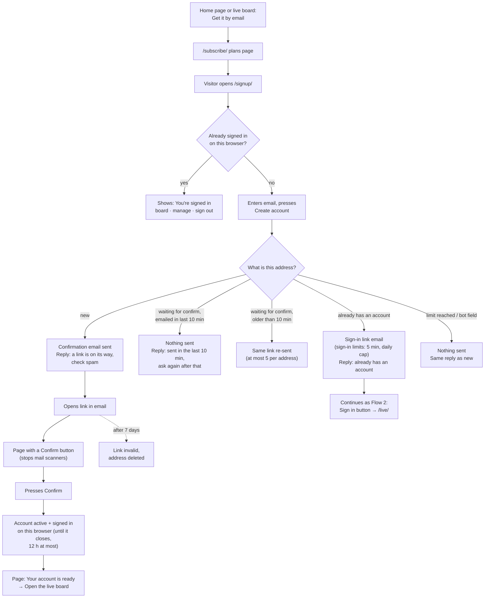
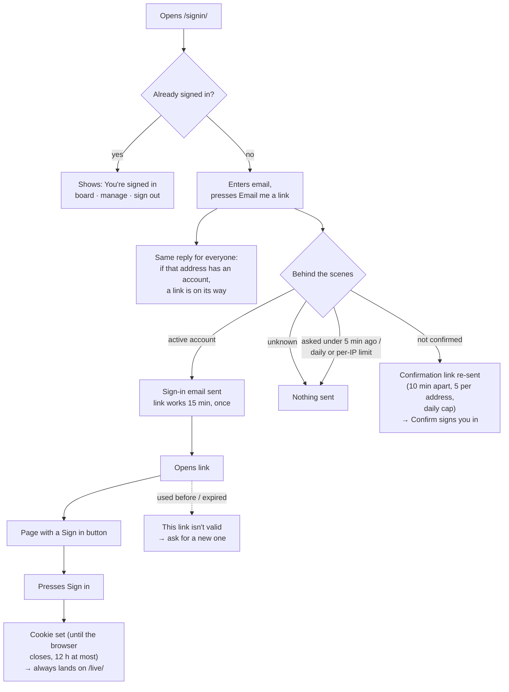
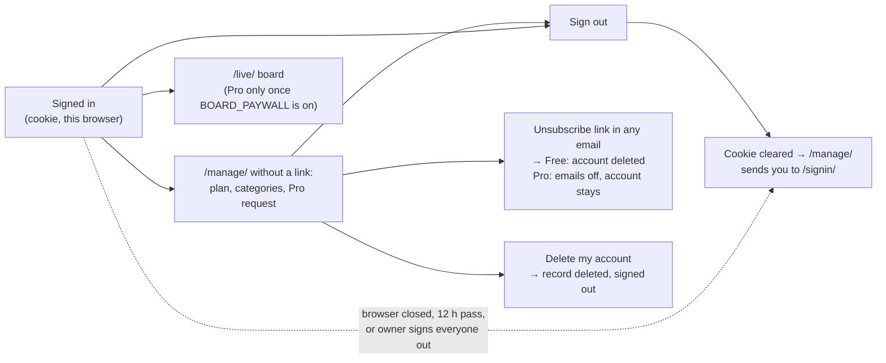
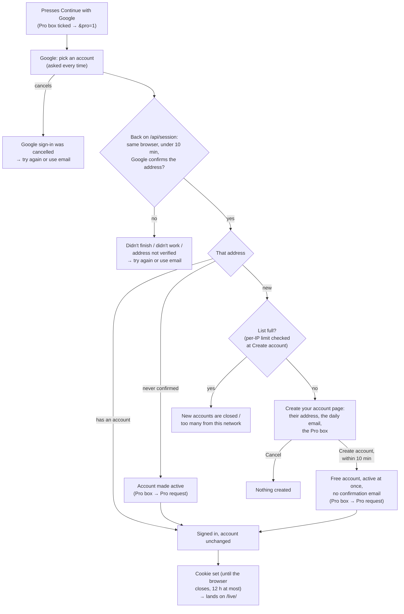

# Account flows: sign-up and sign-in

> **What this is:** the user flows on 2026-10-22, after T16, the `/signup/` page (PR #34) and the fixes for #2 to
> #5 below (branch `fix/account-flows`). They are drawn from the code, not from the plan. Below them is a review
> against common practice for email-only accounts, with ranked changes. #2 to #5 are done; the rest are still
> proposals. Flow 4, Continue with Google (#10), is built but stays hidden until the owner sets it up.
> The design behind these flows: [paid-website.md](paid-website.md). Where the pieces sit:
> [architecture.md](architecture.md).

## Flow 1: Create an account

Entry points:
- `/signup/` ("Create your account"), the one sign-up form, with an "I'd also like Pro" box. It posts to
  `POST /api/subscribe`.
- `/subscribe/` ("Get it by email"), the plans page. The home page and the live board link to it, and its "Create
  your account" button leads to `/signup/` (`/signup/?pro=1` ticks the Pro box).
- `/signin/` also links to `/signup/`.

## Flow 2: Sign in again

Entry points:
- `/signin/`. The home page links to it ("Sign in"), and so do `/subscribe/` and `/signup/`.
- The live board's strip: "Sign in", or "Account" (to `/manage/`) when this browser is signed in.
- `/manage/`, when it has no email link and no cookie.
- Signing up again with an address that already has an account (Flow 1) sends the same sign-in email.

## Flow 3: While signed in

## Flow 4: Continue with Google

Shown only once `GOOGLE_CLIENT_ID` and `GOOGLE_CLIENT_SECRET` are set (see
[DEPLOYMENT.md](../../DEPLOYMENT.md#google-sign-in-optional)); until then the button stays hidden and Flows 1 and
2 are the only ways in. Entry points: the home page popup (both tabs), `/signup/` and `/signin/`. Under the button:
"New here? You'll confirm before a free account is created."

Solid lines are what a person does. Dotted lines are what happens over time or on failure.

**Checked in production on 2026-10-22, with a real inbox:**
- Flow 1, from a pending address to "Your account is ready";
- Flow 3: `/manage/` by cookie and Sign out.

Flow 2's emailed link is not checked yet, and neither are the #4 and #5 changes. See
[progress.md](tasks/progress.md).

## What is right, and should stay

| What | Why |
|---|---|
| No passwords | Nothing to store, leak or reset. The inbox proves who you are, which fits a product that already lives in email. Continue with Google keeps this: Google proves the address, and we keep only the address |
| A button after every link | Mail scanners open links automatically. Requiring a press means they can't confirm or sign anyone in |
| Confirming signs you in | A new user never has to sign in separately right after signing up |
| Short, single-use sign-in links | 15 minutes, once. A forwarded or old email can't be reused |
| The cookie | Signed, `HttpOnly`, ends when the browser closes (12 hours at most), holds no address, and a `POST` from another site is refused |
| Limits and a bot trap | Daily caps, a per-connection limit and a hidden field stop bots from using up the email quota |

## What should change

The items are ranked by how much each one blocks a real person. "Now" means a small fix worth doing before T17,
which sends every visitor through these screens. "With T17" means T17 needs it. "Later" can wait for real users.

| # | Problem | Proposed change | When |
|---|---|---|---|
| 1 | Chrome showed a full-page "Dangerous site" warning on the confirm link, so most new visitors stop there (see [progress.md](tasks/progress.md)) | Move the site to the owner's own domain, then ask Google for a review | Now (parked by the owner) |
| 2 | Nobody can find the account pages. The home page and the live board link only to "Get it by email". `/signup/` is linked only from `/signin/`. Only the account pages show whether you're signed in | Add "Sign in" to the home page and live board nav, and show "Account" there instead when signed in | **Done** (2026-10-22) |
| 3 | Two sign-up pages make one record with different words, and only `/subscribe/` has the Pro box. People can't tell whether a subscription and an account differ | Keep one form. The owner chose: `/subscribe/` becomes the plans page with a "Create account" button to `/signup/`, which gains the Pro box | **Done** (2026-10-22) |
| 4 | A returning user who uses the sign-up form gets "already subscribed" and an email with the manage link. That link doesn't sign them in | For an existing account, send a sign-in link instead. The reply already says the address is subscribed, so this reveals nothing new | **Done** (2026-10-22) |
| 5 | Sign-in for an address that never pressed Confirm says "a link is on its way", and nothing arrives | For a pending address, re-send the confirmation link within the existing limits. The reply stays the same for everyone | **Done** (2026-10-22) |
| 6 | Sign-in always lands on `/live/`, not on the page the person started from | Remember where they started (pages on this site only) and return there after Sign in | Later. T17 didn't need it: the board's panel sends people to sign in, and sign-in lands back on `/live/` |
| 7 | The account is the daily email: unsubscribing deletes the account. Fine for a free newsletter, but a paying Pro user who only wants fewer emails would lose what they paid for | Split "stop emails" from "delete my account": the email link turns emails off, and a manage-page button deletes the account (T17 already plans Delete my account) | **Part done** (T17, 2026-10-23): a Pro's Unsubscribe link turns emails off and keeps the account, and `/manage/` has Delete my account. Free accounts are still deleted by unsubscribing. Cancelling a paid plan comes with T22 |
| 8 | A link opened on a phone signs in the phone, not the laptop that asked | Also put a short code in the sign-in email that can be typed on the page that asked | Later |
| 9 | Two waits the page doesn't explain. A second sign-in request within 5 minutes sends nothing but still says "on its way". A lost confirmation can't be re-sent for 24 hours | Add "You can ask again in 5 minutes" to the sign-in reply. Allow a confirmation re-send after about 10 minutes, still capped per day | **Done** (2026-10-22): re-send after 10 minutes, at most 5 per address |
| 10 | Every way in waits for an email. When one is slow, lost or blocked (#1), the person is stuck | Add "Continue with Google" beside the emailed link. A new address sees "Create your account" and gets a free account when it presses Create account, with no confirmation email | **Built** (2026-10-22). The confirm step was added the same day, at the owner's request |

**Suggested order:**
1. The domain (#1), when the owner picks it up again.
2. ~~One small PR for #2 to #5~~: done on branch `fix/account-flows`, with no new server function.
3. ~~#7 inside T17~~: done for Pro. #6 moved to Later.
4. #8 once there are real users asking. (#9 was done early, on 2026-10-22, after the owner hit it.)
