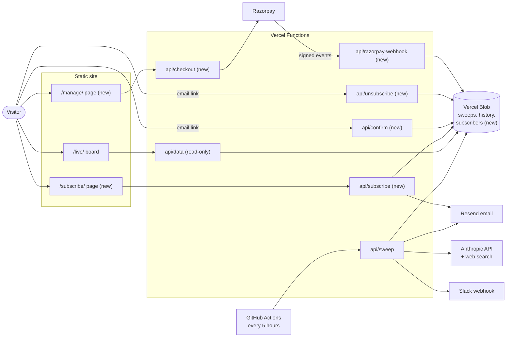
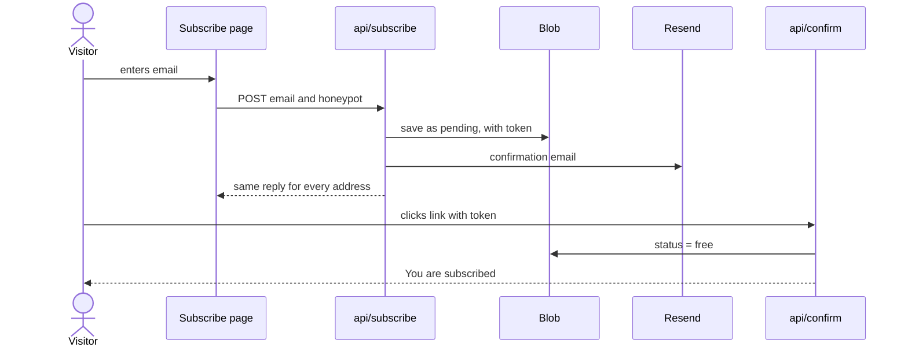
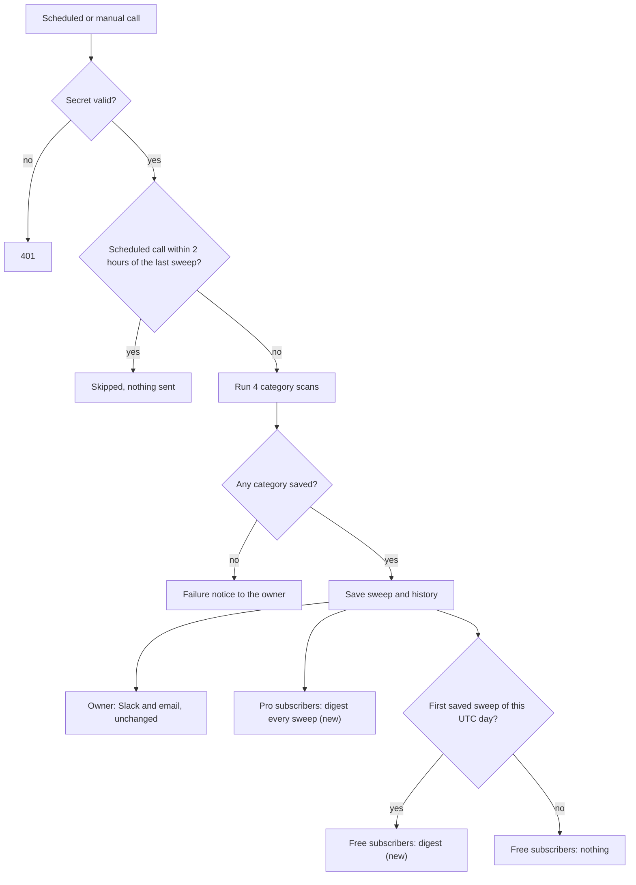
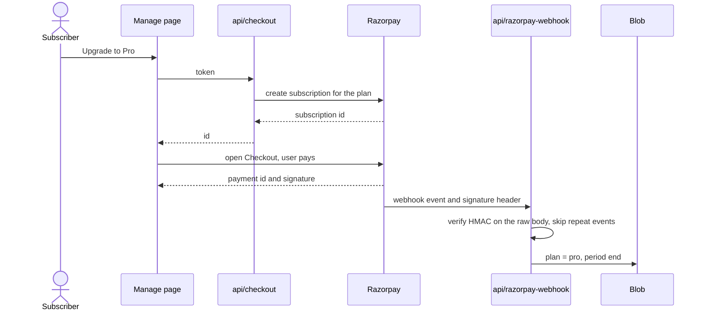
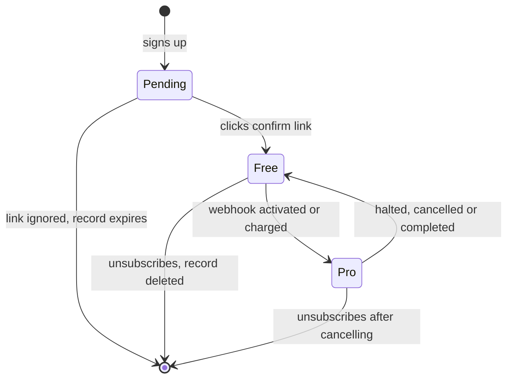
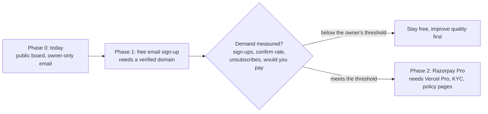

# Subscriptions: how the pieces fit together

> **Draft proposal, nothing here is built.** Written on 21 Oct 2026 from the current code and
> [DEPLOYMENT.md](../../DEPLOYMENT.md). Items marked **new** do not exist yet. The design is split across three
> documents: [pricing and rollout](pricing.md), [free email sign-up](email-signup.md) and
> [paid Pro through Razorpay](payments-razorpay.md).

## What exists today and what would be added

| Today | Added by this plan |
|---|---|
| A sweep every 5 hours (GitHub Actions, plus Vercel's daily cron as a backstop) | Nothing changes in how a sweep is gathered or saved |
| The sweep emails and Slack-posts the owner only | After the owner's delivery, a digest to confirmed subscribers |
| A public board that anyone can read | A sign-up page, a confirm link, an unsubscribe link |
| No accounts, no payments | A subscriber record per address; later, a paid plan checked against Razorpay's signed events |

The cost of a sweep (about $0.21, or about $32 a month at 5 sweeps a day) does not depend on the number of
subscribers. Subscribers add email volume, not AI calls.

## A. System map

## B. Free sign-up with double opt-in

## C. Sweep to delivery (extends today's `deliver()` step)

## D. Paid Pro through Razorpay (later)

## E. Subscriber states

## F. Rollout order with gates

## Everything the plan adds, in one place

| Kind | Name | Used by | Defined in |
|---|---|---|---|
| Page | `/subscribe/` | Visitors | [email-signup.md](email-signup.md) |
| Page | `/manage/` | Subscribers (Phase 2) | [payments-razorpay.md](payments-razorpay.md) |
| Endpoint | `POST /api/subscribe` | Subscribe page | [email-signup.md](email-signup.md) |
| Endpoint | `GET /api/confirm` | Link in the confirmation email | [email-signup.md](email-signup.md) |
| Endpoint | `GET` and `POST /api/unsubscribe` | Link in every digest | [email-signup.md](email-signup.md) |
| Endpoint | `POST /api/checkout` | Manage page (Phase 2) | [payments-razorpay.md](payments-razorpay.md) |
| Endpoint | `POST /api/razorpay-webhook` | Razorpay (Phase 2) | [payments-razorpay.md](payments-razorpay.md) |
| Blob key | `radar:sub:<hash of email>` | All of the above | [email-signup.md](email-signup.md) |
| Blob key | `radar:lastFreeDigestAt` | Sweep handler | [email-signup.md](email-signup.md) |
| Blob key | `radar:rzp-event:<id>` | Webhook | [payments-razorpay.md](payments-razorpay.md) |
| Variable | `EMAIL_FROM` (existing), `MAX_SUBSCRIBERS`, `SITE_URL`, `UNSUBSCRIBE_SECRET` | Email | [email-signup.md](email-signup.md) |
| Variable | `RAZORPAY_KEY_ID`, `RAZORPAY_KEY_SECRET`, `RAZORPAY_WEBHOOK_SECRET`, `RAZORPAY_PLAN_ID` | Payments | [payments-razorpay.md](payments-razorpay.md) |

Everything in the Blob store stays private. `/api/data` serves only history and sweep keys, so none of the new keys
can be read through it (a test should prove this when the code is written).
