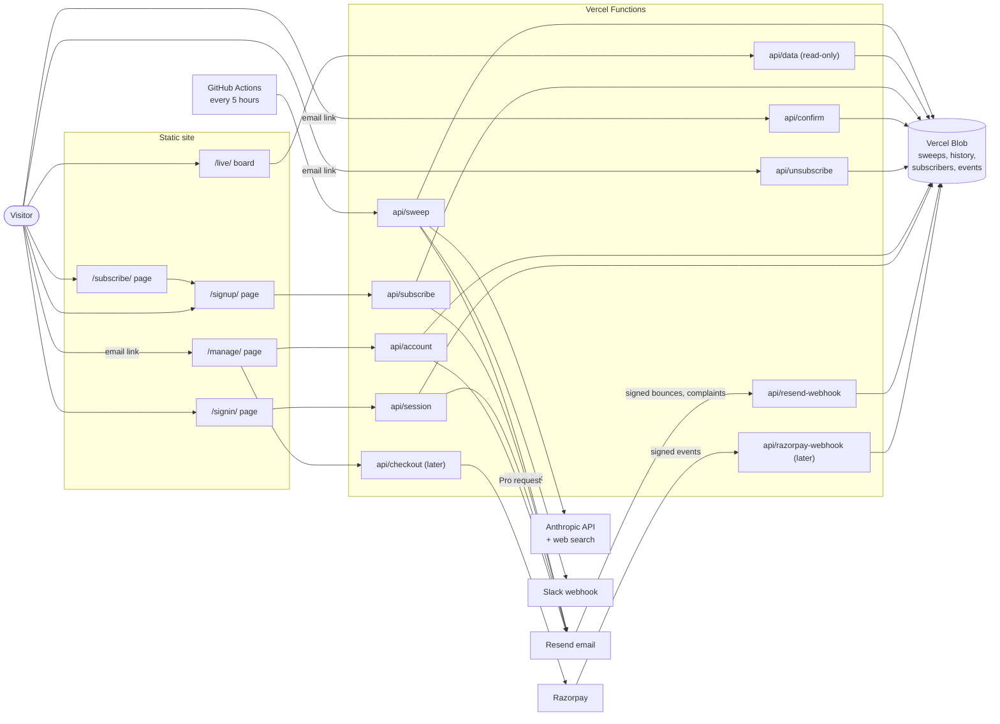
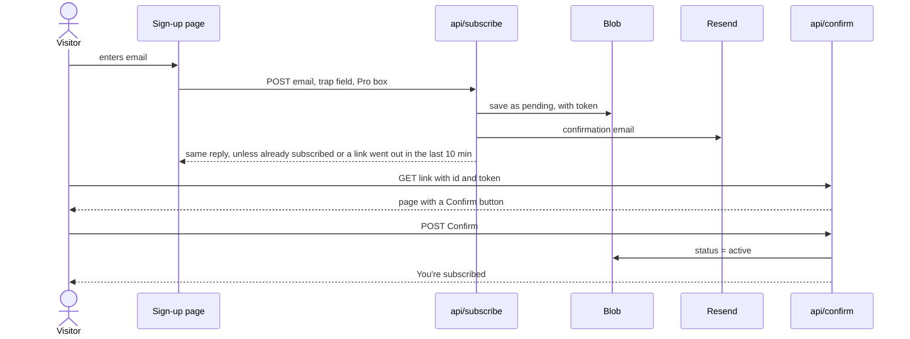
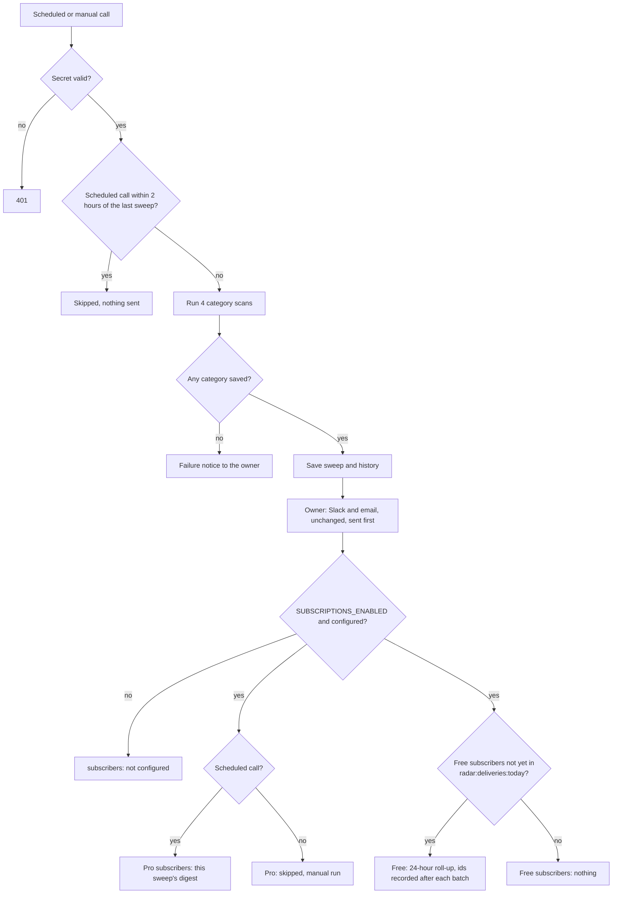
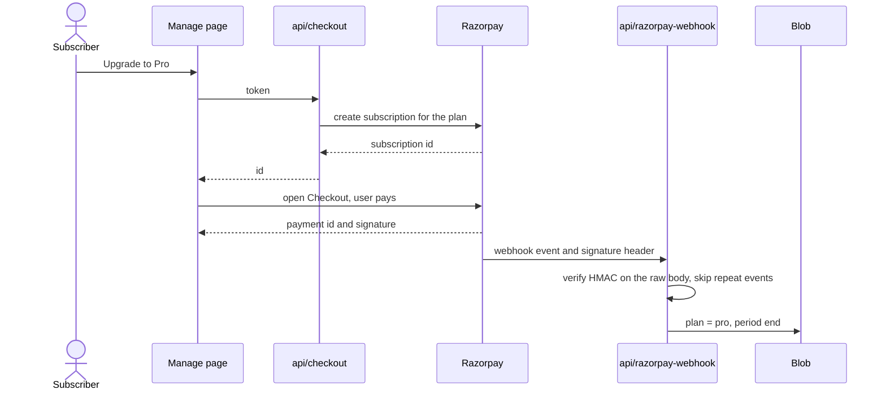
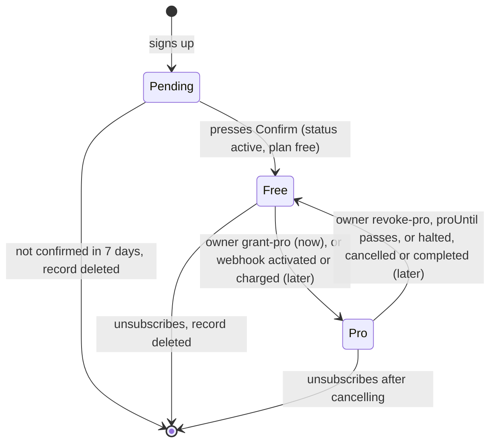
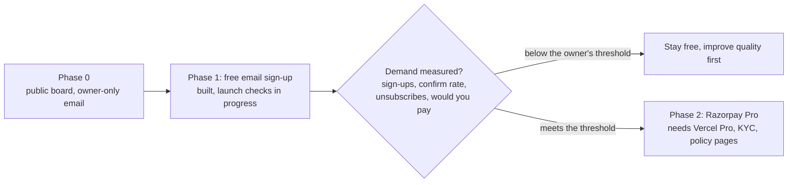

# Subscriptions: how the pieces fit together

> **Phase 1 (free email sign-up) is built** and switched on in production since 21 Oct 2026; launch checks are in
> progress ([T12](tasks/T12-docs-and-launch.md)). **Phase 2 (Razorpay) is not built.** Items marked **later** do not
> exist yet. The design is split across four documents: [pricing and rollout](pricing.md),
> [free email sign-up](email-signup.md), [the paid website](paid-website.md) (planned 2026-10-22: Pro pays for the live
> board, with sign-in by email link) and [paid Pro through Razorpay](payments-razorpay.md). The sign-up and sign-in
> user flows as built, with a review: [account-flows.md](account-flows.md). How to run what is
> built: [DEPLOYMENT.md](../../DEPLOYMENT.md#subscriber-email-optional).

## What existed before and what was added

| Before | Added in Phase 1 (built) | Phase 2 (later) |
|---|---|---|
| A sweep every 5 hours (GitHub Actions, plus Vercel's daily cron as a backstop) | Nothing changed in how a sweep is gathered or saved | — |
| The sweep emails and Slack-posts the owner only | After the owner's delivery, a digest to confirmed subscribers | — |
| A public board that anyone can read | A sign-up page, a confirm page, an unsubscribe link, a manage page | Checkout on the manage page |
| No accounts, no payments | A subscriber record per address; Pro granted by the owner on request | Pro checked against Razorpay's signed events |

The cost of a sweep (about $0.21, or about $32 a month at 5 sweeps a day) does not depend on the number of
subscribers. Subscribers add email volume, not AI calls.

## A. System map

## B. Free sign-up with double opt-in

## C. Sweep to delivery (extends today's `deliver()` step)

## D. Paid Pro through Razorpay (later)

## E. Subscriber states

## F. Rollout order with gates

## Everything the plan adds, in one place

| Kind | Name | Used by | Status | Defined in |
|---|---|---|---|---|
| Page | `/subscribe/` | Visitors: the plans page (Free and Pro), links to `/signup/` | Built | [email-signup.md](email-signup.md) |
| Page | `/manage/` | Subscribers: plan and Request Pro now, checkout later | Built (checkout later) | [email-signup.md](email-signup.md), [payments-razorpay.md](payments-razorpay.md) |
| Endpoint | `POST /api/subscribe` | Sign-up page | Built | [email-signup.md](email-signup.md) |
| Endpoint | `GET` and `POST /api/confirm` | Link in the confirmation email | Built | [email-signup.md](email-signup.md) |
| Endpoint | `GET` and `POST /api/unsubscribe` | Link and one-click header in every email | Built | [email-signup.md](email-signup.md) |
| Page | `/signin/` | Subscribers: sign in by an emailed link, sign out | Built (T16) | [paid-website.md](paid-website.md) |
| Page | `/signup/` | Visitors: "Create your account", the one sign-up form (`POST /api/subscribe`), email and the Pro box | Built | [paid-website.md](paid-website.md) |
| Endpoint | `GET` and `POST /api/account` | Manage page, by email link or login cookie | Built | [email-signup.md](email-signup.md) |
| Endpoint | `GET` and `POST /api/session` | Sign-in page and sign-in link: request a link, sign in, sign out, "who am I" | Built (T16) | [paid-website.md](paid-website.md) |
| Cookie | `tpr_session` (signed with `SESSION_SECRET`, ends when the browser closes, 12 hours at most) | Confirm and sign-in set it; account and session read it | Built (T16) | [paid-website.md](paid-website.md) |
| Endpoint | `POST /api/resend-webhook` | Resend (bounces and complaints) | Built (T13) | [DEPLOYMENT.md](../../DEPLOYMENT.md#subscriber-email-optional) |
| Endpoint | `POST /api/checkout` | Manage page | Later | [payments-razorpay.md](payments-razorpay.md) |
| Endpoint | `POST /api/razorpay-webhook` | Razorpay | Later | [payments-razorpay.md](payments-razorpay.md) |
| Blob key | `radar:sub:<hash of email>` | All of the above | Built | [email-signup.md](email-signup.md) |
| Blob key | `radar:event:<day>-<time>-<type>-<random>` | Sign-up metrics, `stats` | Built | [email-signup.md](email-signup.md) |
| Blob key | `radar:deliveries:<YYYYMMDD>` | Sweep handler (Free sends) | Built | [email-signup.md](email-signup.md) |
| Blob key | `radar:subscriberCount` | Sign-up cap | Built | [email-signup.md](email-signup.md) |
| Blob key | `radar:iphit:<hour>-<hash of IP>-<random>` | Per-IP sign-up limit | Built (T13) | [email-signup.md](email-signup.md) |
| Blob key | `radar:rzp-event:<id>` | Webhook | Later | [payments-razorpay.md](payments-razorpay.md) |
| Variable | `EMAIL_FROM` (on a verified domain), `SUBSCRIPTIONS_ENABLED`, `MAX_SUBSCRIBERS`, `MAX_CONFIRMS_PER_DAY`, `SITE_URL`, `MAX_SIGNUPS_PER_IP_HOUR`, `RESEND_WEBHOOK_SECRET` | Email | Built | [DEPLOYMENT.md](../../DEPLOYMENT.md#environment-variables) |
| Variable | `SESSION_SECRET`, `MAX_SIGNINS_PER_DAY` | Sign-in | Built (T16) | [DEPLOYMENT.md](../../DEPLOYMENT.md#signing-in-t16) |
| Variable | `GOOGLE_CLIENT_ID`, `GOOGLE_CLIENT_SECRET` | Continue with Google | Built, not set | [DEPLOYMENT.md](../../DEPLOYMENT.md#google-sign-in-optional) |
| Variable | `RAZORPAY_KEY_ID`, `RAZORPAY_KEY_SECRET`, `RAZORPAY_WEBHOOK_SECRET`, `RAZORPAY_PLAN_ID` | Payments | Later | [payments-razorpay.md](payments-razorpay.md) |

Everything in the Blob store stays private. `/api/data` serves only history and sweep keys, so none of the new keys
can be read through it; `npm test` checks that each subscriber key is refused.
