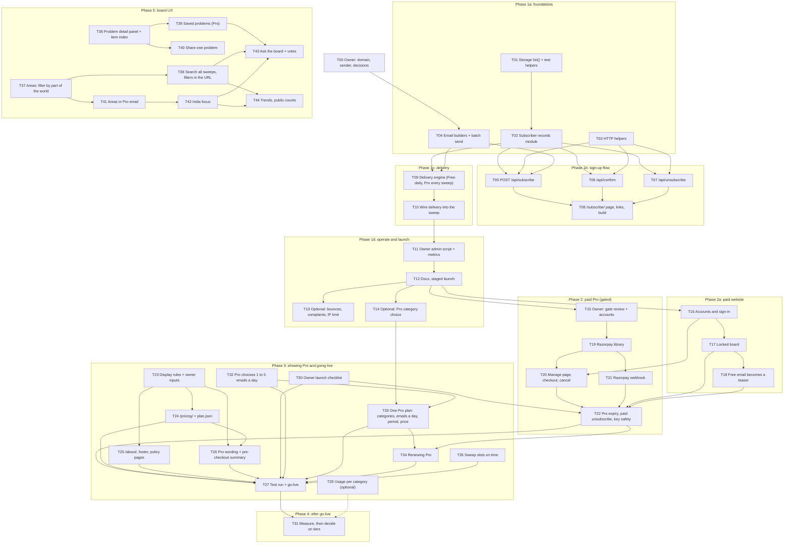

# Subscription tasks: Free and Pro email digests

> **Implementation backlog, nothing here is built yet.** Written on 21 Oct 2026 from the current code (`api/_lib/`,
> `scripts/`, `vercel.json`, `.github/workflows/`) and the draft designs in this folder's parent:
> [architecture.md](../architecture.md), [email-signup.md](../email-signup.md), [pricing.md](../pricing.md),
> [payments-razorpay.md](../payments-razorpay.md). Anything that depends on an outside service's current behaviour
> (Resend, Vercel Blob, Vercel limits, Razorpay) is marked **verify at build time**. Sizes are rough guesses, not
> measurements.

> **Changed 2026-10-22:** Pro now pays for the live board on the website, not for email
> ([paid-website.md](../paid-website.md)). T16 to T18 add accounts, sign-in, the locked board and the teaser email;
> T20 now also needs T16.
>
> **Renumbered 2026-10-22** so the numbers follow the build order. Was → now: T20 → T16, T21 → T17, T22 → T18,
> T16 → T19, T17 → T20, T18 → T21, T19 → T22. Merged PR titles and older CHANGELOG lines keep the old numbers.

## The requirement

People subscribe with an email address to get the digest by email. There are two plans:

| Plan | What they get | When |
|---|---|---|
| **Free** | One digest a day | After the first saved sweep of each UTC day (the 00:17 UTC run, about 05:47 IST, when GitHub starts it on time) |
| **Pro** | A digest every time the data updates | After the scheduled sweeps the member chose: 1 to 5 a day, default 2 ([T32](T32-sweeps-per-day.md)) |

The owner's own Slack post and `EMAIL_TO` email stay exactly as they are today.

## How the work is split

The work is in phases. Each phase ships on its own and leaves the site working. Phase 3 (T23 to T27, added
2026-10-23) shows Pro's price and terms on the site and takes Razorpay live. T28 to T31 (added 2026-10-24) carry
out the [final Pro plan](../pricing.md#final-pro-plan-2026-10-24): the owner's launch steps and a measurement gate
after launch. T32 (added 2026-10-24) lets each Pro member choose 1 to 5 emails a day and replaces T28's fixed 2 a
day. T33 to T35 (added 2026-10-25, at the owner's request) make Pro one plan the member builds and pays for
(categories and emails a day chosen freely, one price paid monthly or yearly, simplified 2026-10-26), add renewal, and keep the sweep slots right when GitHub runs
late. T33 brings forward the tier decision T31 had left until after launch. Phase 5 (T36 to T41, added 2026-10-29)
improves the board itself: a detail panel, areas, search across sweeps, saved problems, share links and areas in Pro
email. Its ideas came from a comparison with Mindtrip (mindtrip.ai), read from public write-ups because its site
didn't render in a headless browser. Each one is built only when the owner says go. T42 (added 2026-10-30, at the owner's request) asks every
category call for up to 2 items about India and makes India its own area. T43 (added 2026-10-31, at the owner's
request) lets Pro members ask the board a question, answered by AI only from saved items, and mark items Useful or
Not useful. T44 (added 2026-10-31, at the owner's request) adds a public `/trends/` page: counts of new problems by
area and category over time, and what's rising, with no item text.

**Pro before payments.** Phase 1 builds both plans. Until Phase 2, the owner grants Pro by hand with the admin
script (T11), for example to test users or early supporters. Phase 2 adds Razorpay so people can pay for Pro
themselves. It is built only if the Phase 1 numbers pass the owner's gate ([pricing.md](../pricing.md)).

## Task list

| ID | Task | Who | Size | Depends on |
|---|---|---|---|---|
| [T00](T00-owner-prerequisites.md) | Domain, sender and decisions | Owner | S | — |
| [T01](T01-storage-list.md) | Add `list(prefix)` to storage; share test helpers | Dev | S | — |
| [T02](T02-subscriber-records.md) | Subscriber records module (`api/_lib/subscribers.js`) | Dev | M | T01 |
| [T03](T03-http-helpers.md) | HTTP helpers: body reader, HTML pages, method checks | Dev | S | — |
| [T04](T04-email-builders.md) | Confirmation email, subscriber digest, batch sending | Dev | M | T00 (sender) |
| [T05](T05-api-subscribe.md) | `POST /api/subscribe` | Dev | M | T02, T03, T04 |
| [T06](T06-api-confirm.md) | `GET` and `POST /api/confirm` | Dev | S | T02, T03 |
| [T07](T07-api-unsubscribe.md) | `GET` and `POST /api/unsubscribe`, one-click | Dev | S | T02, T03 |
| [T08](T08-subscribe-page.md) | `/subscribe/` page, links, build step, checks | Dev | M | T05, T06, T07 |
| [T09](T09-delivery-engine.md) | Delivery engine: Free daily roll-up, Pro every sweep | Dev | L | T02, T04 |
| [T10](T10-sweep-integration.md) | Call delivery from the sweep handler | Dev | M | T09 |
| [T11](T11-admin-script-and-metrics.md) | Owner admin script, manual Pro, sign-up metrics | Dev | M | T10 |
| [T12](T12-docs-and-launch.md) | Docs and staged launch of Phase 1 | Dev + Owner | M | T11 |
| [T13](T13-optional-hardening.md) | Optional: bounces, complaints, per-IP limit | Dev | M | T12 |
| [T14](T14-optional-pro-categories.md) | Optional: Pro subscribers choose categories | Dev | M | T12 |
| [T15](T15-phase2-gate-and-accounts.md) | Phase 2 gate review and accounts | Owner | S | T12 + measuring period |
| [T16](T16-accounts-and-sign-in.md) | Accounts and sign-in: email link, login cookie, `/signin/` | Dev | L | T12 |
| [T17](T17-locked-board.md) | Locked board behind `BOARD_PAYWALL`; Pro survives unsubscribe | Dev | M | T16 |
| [T18](T18-teaser-email.md) | Free email becomes a teaser | Dev | S | T17 |
| [T19](T19-razorpay-library.md) | `api/_lib/razorpay.js`: signatures and API calls | Dev | M | T15 |
| [T20](T20-manage-page-and-checkout.md) | `/manage/` page, checkout, cancel | Dev | L | T16, T19 |
| [T21](T21-razorpay-webhook.md) | `POST /api/razorpay-webhook` | Dev | M | T19, T20 |
| [T22](T22-pro-lifecycle-and-go-live.md) | Pro expiry, paid unsubscribe, key safety | Dev | M | T17, T18, T20, T21 |
| [T23](T23-pro-display-standards.md) | How Pro is shown: transparency and UI/UX rules, owner inputs | Owner + Dev | S | — |
| [T24](T24-pricing-page.md) | `/pricing/` page; `plan.json` as the one source for price and refund rule | Dev | M | T23 |
| [T25](T25-about-footer-legal.md) | `/about/`, footer on every page, ship terms, refunds, contact | Owner + Dev | M | T23 |
| [T26](T26-pro-copy-and-checkout-summary.md) | Pro wording on existing pages; summary before checkout | Dev | M | T23, T24 |
| [T27](T27-razorpay-test-run-and-go-live.md) | Razorpay test-mode run and go-live | Owner + Dev | M | T22, T24, T25, T26, T30, T32, T33, T34, T35 |
| [T28](T28-two-sweeps-a-day.md) | ~~Move to 2 sweeps a day~~: replaced by T32, not to be built | — | — | — |
| [T29](T29-usage-by-category.md) | Optional: usage per category in each saved sweep | Dev | S | — |
| [T30](T30-owner-launch-checklist.md) | Owner launch checklist: credit, Vercel Pro, Razorpay activation, terms, limits, refunds | Owner | L | — |
| [T31](T31-measure-and-add-tiers.md) | After launch: measure, then adjust T33's prices | Owner + Dev | S | T27 + 20 to 30 paying members |
| [T32](T32-sweeps-per-day.md) | Each Pro member chooses 1 to 5 emails a day; the site sweeps only as often as needed; schedule wording on every page | Dev | L | — |
| [T33](T33-pro-plan-builder.md) | One Pro plan: categories (one, several, all) and 1 to 5 emails a day, one price, paid monthly or yearly; test mode on an up-to-date `staging` first | Owner + Dev | L | Owner inputs P1 to P5, T14, T32 |
| [T34](T34-renew-pro.md) | Renewing Pro: resume a cancelled plan, renew after it ends, warn before a plan that won't renew ends | Dev | M | T22, T33 |
| [T35](T35-sweep-slots-on-time.md) | Sweep slots that survive GitHub's late runs: the due slot sent by the workflow, one sweep per slot | Dev | S | — |
| [T36](T36-problem-detail-panel.md) | Problem detail panel: full fields, "first seen" and "in N sweeps" from a new `radar:items` index, `#p=<id>` deep link | Dev | M | — |
| [T37](T37-areas.md) | Areas: a fixed area list, `areaOf(region)` in the jsx and the server, area chips and an overview strip on the board | Dev | M | — |
| [T38](T38-search-all-sweeps.md) | Search all saved sweeps; `?q=`, `?cat=`, `?area=` in the URL; a search box on the home page | Dev | M | T37 (for `?area=`) |
| [T39](T39-saved-problems.md) | Saved problems for Pro: a star on each card, a Saved tab, up to 100 on the account record | Dev | M | T36 |
| [T40](T40-share-a-problem.md) | Share one problem: `/p/<sweep>/<item>` with a preview card; headline-level fields for non-Pro | Dev | M | T36 |
| [T41](T41-email-areas.md) | Pro email: choose areas as well as categories | Dev | M | T37 |
| [T42](T42-india-focus.md) | India focus: up to 2 India items in each category call, 4 searches, India as its own area, India's share from the logs | Dev | M | T37, T41 |
| [T43](T43-ask-the-board.md) | Ask the board (RAG, Pro, off unless `ASK_ENABLED=1`): an answer only from saved items, each claim citing one; Useful / Not useful votes; `item-votes.mjs` | Dev | L | T38, T39, T42 |
| [T44](T44-trends.md) | Trends (public, counts only): a tally of new problems per day by category and area in the search file; `/api/data?key=radar:trends`; the `/trends/` page with weekly and 30-day charts and a rising list | Dev | M | T37, T38, T42 |

## Decisions to settle before or during the build (OWNER INPUT NEEDED)

Each row has a recommended default so work can start. The tasks are written for the default; the task named in the
last column says what changes if the owner picks otherwise. Record each final choice in T00.

| # | Question | Recommended default | Why | Affects |
|---|---|---|---|---|
| D1 | How does someone get Pro before payments exist? | The owner grants it with the admin script | No payment code to build or secure until demand is shown | T11 |
| D2 | What does the Free daily email contain? | A **roll-up** of every item saved in the last 24 hours, with New flags kept | With only the first sweep of the day, Free readers never see items found at 05:17–20:17 UTC, and their New flags are used up before the next morning | T09 |
| D3 | When does the Free email go out? | After the first saved sweep of the UTC day (00:17 UTC, about 05:47 IST) | Matches the existing schedule; no new timer | T09 |
| D4 | Do Pro subscribers get the owner's manual runs? | No, scheduled sweeps only | Manual runs are usually tests; each one would email paying users | T09 |
| D5 | Does Pro get an email when a sweep finds nothing new? | Yes, every saved scheduled sweep (as asked) | Matches "whenever data is updated". Option: skip when `newCount` is 0, to cut noise and complaints | T09 |
| D6 | Can subscribers choose categories? | Not in the first release; Pro only, later (T14). The owner picked T14 on 2026-10-22, and it is built | Keeps Phase 1 small | T14 |
| D7 | Cap on subscribers (`MAX_SUBSCRIBERS`) | No default: unset means sign-ups are closed. **Owner set `5000`** (above the free Resend quota; see T00) | The owner must set it from the quota formula in [pricing.md](../pricing.md) | T05 |
| D8 | Domain and sender name | Domain `pehchanthetraveller.com` (verified in Resend, DMARC set). Sender `hello@pehchanthetraveller.com` | Required: the shared Resend sender cannot reach other people | T00 |
| D9 | Confirm link: one click, or a page with a button? | A page with a **Confirm** button that posts | Mail security scanners open links in emails, which would confirm addresses nobody asked to subscribe | T06 |
| O1 | Which areas? | Global, Asia, Europe, North America, Latin America, Middle East & Africa, Oceania, Other | Few enough for one row of chips; covers every region in the sample sweep | T37 |
| O2 | Are Global items always in area-filtered emails? | Yes | A worldwide problem affects every area | T41 |
| O3 | What does a non-Pro visitor see on a shared problem? | Headline, category, source name, region, date, severity | The same as the free teaser email already shows | T40 |
| O4 | Can search engines index shared problem pages? | No (`noindex`) | Keeps Pro content and old headlines out of search results; easy to turn on later | T40 |
| O5 | Most saved problems per account | 100 | Keeps the account record small | T39 |
| O6 | Does choosing areas change Pro's price? | No | It narrows the email; it costs nothing extra to run | T41 |
| O7 | How are India items found? | **Owner's choice, 2026-10-30:** up to 2 more in each category call, with one more search | Uses the calls that already run; a separate India-only call waits on a week of readings (RM-38) | T42 |

## Where these tasks differ from the draft designs

The drafts were written before the code was read line by line. These changes fix problems found while writing the
tasks. T12 updates [email-signup.md](../email-signup.md) and [architecture.md](../architecture.md) to match.

| Draft said | Tasks do | Why |
|---|---|---|
| One `status` field: `pending`, `free` or `pro` | Two fields: `status` (`pending` or `active`) and `plan` (`free` or `pro`), with `proUntil` | A paid plan can expire or lapse while the address stays confirmed |
| Links carry `?token=...` only | Links carry `?id=<record id>&t=<token>` | Without the id, finding the record means reading every subscriber file |
| `radar:lastFreeDigestAt`, one marker for the day | `radar:deliveries:<YYYYMMDD>`, the list of record ids already sent today, written only by the sweep | A send cut off halfway can resume at the next sweep without double-sending, and user actions never overwrite it |
| Free gets the first sweep of the day | Free gets a 24-hour roll-up (D2) | See D2 |
| `UNSUBSCRIBE_SECRET` | Not needed | Tokens are random and stored on the record |
| No on/off switch | `SUBSCRIPTIONS_ENABLED` turns sign-up and delivery on together | Lets the code ship to production switched off, and gives a one-step way to stop all subscriber mail |
| Cap with no default | Unset `MAX_SUBSCRIBERS` means closed | Fails safe; no invented number |
| Sign-up metrics not designed | Event records with no addresses, `radar:event:...` (T11) | The Phase 2 gate needs sign-up, confirm and unsubscribe counts, and deleted records leave no trace |

## Rules every task follows

These come from how the current code already works. A task is not done until each one holds.

1. **No addresses, tokens or keys in any reply or log line.** The GitHub Actions job prints the `/api/sweep` reply
   in a public log. Subscriber results are counts only, the same rule `sendEmail()` already follows.
2. **The owner's delivery does not change.** `EMAIL_TO`, Slack and their existing tests stay as they are. All 68
   current tests must still pass.
3. **Subscriber work never fails or slows the sweep's save.** It runs after the save, never throws, and stops
   before the 300-second limit.
4. **Handlers take their dependencies as arguments** (`env`, `storage`, `fetchFn`, `now`, a random source), like
   `makeSweepHandler`, so the offline tests can run them with fakes.
5. **Tests are offline.** No network, no API key. New tests go in `scripts/test-subscriptions.mjs` (T01), run by
   `npm test`.
6. **Subscriber data stays private.** `/api/data` keeps serving history and sweep keys only; a test proves each new
   key prefix is refused.
7. **No new npm packages** unless the owner agrees. The current code uses plain `fetch` and `node:crypto`; keep it
   that way.
8. **Docs move with the code.** Each task lists the docs it touches. Claims stay evidence-based: "tested offline"
   until a real send is seen in an inbox.

## Definition of done for each task

- [ ] Code and tests written as the task describes; `npm run build && npm run check && npm test` passes
- [ ] Each acceptance criterion in the task is checked off
- [ ] Each **verify at build time** item is checked against the service's current docs, and the result noted in the
  pull request
- [ ] Docs listed in the task are updated
- [ ] One small commit or pull request per task, with a message that says what changed and why
