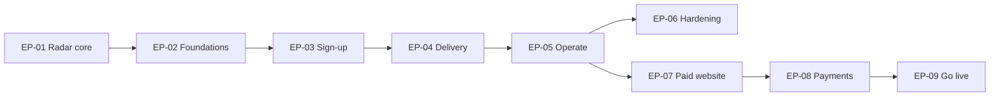

# Backlog by epic

> **Stage 2 of 7.** The build tasks `T00` to `T27` grouped into epics, with each one's status on 2026-10-23. Each
> task file has its acceptance criteria. The statuses come from [progress.md](../../docs/subscriptions/tasks/progress.md)
> and the git history; where a later pull request changed one, that pull request is named. Sizes (S, M, L) were
> guesses made when the tasks were written, not measurements.

## Epics

| Epic | Goal | Tasks | Requirements | Status |
|---|---|---|---|---|
| EP-01 Radar core | Find, sort and keep travel problems; a demo and a live page | Before the task list: July 2026 to 19 Oct 2026 | REQ-01 to REQ-11 | Done |
| EP-02 Subscriber foundations | Storage, records, HTTP helpers, emails | T00 to T04 | REQ-17 | Done |
| EP-03 Sign-up flow | Double opt-in sign-up and unsubscribe | T05 to T08 | REQ-12, REQ-13, REQ-18 | Done |
| EP-04 Delivery | Free daily and Pro every sweep, inside the sweep | T09, T10 | REQ-14 to REQ-16 | Done |
| EP-05 Operate and launch | Admin script, metrics, staged launch, and the fixes it found | T11, T12, fixes | REQ-19, REQ-22 | One launch check open |
| EP-06 Hardening and options | Bounces, complaints, rate limit; Pro picks categories | T13, T14 | REQ-20, REQ-21 | Done |
| EP-07 Paid website | Accounts, a locked board, a teaser email | T16 to T18 | REQ-23 to REQ-25 | Done; live |
| EP-08 Payments | Razorpay checkout, webhook, Pro lifecycle | T15, T19 to T22 | REQ-26 to REQ-28 | Built and tested on staging; T22 to do |
| EP-09 Showing Pro and going live | Honest pricing pages and a go-live run | T23 to T27 | REQ-29 to REQ-31 | Pages live with `paid: false`; go-live waits on the owner |

## Tasks

| Task | Epic | What | Size | Status | Evidence |
|---|---|---|---|---|---|
| [T00](../../docs/subscriptions/tasks/T00-owner-prerequisites.md) | EP-02 | Domain, sender and decisions D1 to D9 | S | Done (owner-reported, 2026-10-21) | Domain verified in Resend, DMARC set |
| [T01](../../docs/subscriptions/tasks/T01-storage-list.md) | EP-02 | Storage `list()` and test helpers | S | Done | `9175e84` |
| [T02](../../docs/subscriptions/tasks/T02-subscriber-records.md) | EP-02 | Subscriber records module | M | Done | `f0de053` |
| [T03](../../docs/subscriptions/tasks/T03-http-helpers.md) | EP-02 | HTTP helpers | S | Done | `536cc33` |
| [T04](../../docs/subscriptions/tasks/T04-email-builders.md) | EP-02 | Email builders and batch sending | M | Done | `87bbdcb` |
| [T05](../../docs/subscriptions/tasks/T05-api-subscribe.md) | EP-03 | `POST /api/subscribe` | M | Done | `0f718c3` |
| [T06](../../docs/subscriptions/tasks/T06-api-confirm.md) | EP-03 | `/api/confirm` | S | Done | `15c4478` |
| [T07](../../docs/subscriptions/tasks/T07-api-unsubscribe.md) | EP-03 | `/api/unsubscribe`, one-click | S | Done | `5dfa7be` |
| [T08](../../docs/subscriptions/tasks/T08-subscribe-page.md) | EP-03 | `/subscribe/` page, build and checks | M | Done | `147fd24` |
| [T09](../../docs/subscriptions/tasks/T09-delivery-engine.md) | EP-04 | Delivery engine | L | Done | `ef7831b` |
| [T10](../../docs/subscriptions/tasks/T10-sweep-integration.md) | EP-04 | Delivery wired into the sweep | M | Done | `0d3b008` |
| [T11](../../docs/subscriptions/tasks/T11-admin-script-and-metrics.md) | EP-05 | Admin script and metrics | M | Done | `d344d34` |
| Request Pro | EP-05 | Ask for Pro at sign-up or on `/manage/`; the owner grants it by hand | — | Done | PR #8 |
| Fresh reads | EP-05 | Storage reads skip the CDN cache, except the data feed's | — | Done | PR #9 |
| [T12](../../docs/subscriptions/tasks/T12-docs-and-launch.md) | EP-05 | Docs and staged launch | M | Docs done; launch has one check open: a Pro email with one category | progress.md |
| One inbox | EP-05 | One subscription per inbox | — | Done; checked on production | PR #19 |
| Old links | EP-05 | Old unsubscribe links say "no longer active" | — | Done | PR #23 |
| [T13](../../docs/subscriptions/tasks/T13-optional-hardening.md) | EP-06 | Bounces, complaints, per-IP limit | M | Done; live with the webhook and firewall rule | PR #12 |
| [T14](../../docs/subscriptions/tasks/T14-optional-pro-categories.md) | EP-06 | Pro chooses categories | M | Done; live. The email side not yet checked | PR #18 |
| [T15](../../docs/subscriptions/tasks/T15-phase2-gate-and-accounts.md) | EP-08 | Phase 2 gate and accounts | S | In progress. The owner skipped the gate; prerequisites started | progress.md |
| [T16](../../docs/subscriptions/tasks/T16-accounts-and-sign-in.md) | EP-07 | Accounts and sign-in | L | Done. Sign-up checked in production, the sign-in link not yet | progress.md |
| [T17](../../docs/subscriptions/tasks/T17-locked-board.md) | EP-07 | Locked board | M | Done; switched on in production 2026-10-23 | progress.md |
| [T18](../../docs/subscriptions/tasks/T18-teaser-email.md) | EP-07 | Free email becomes a teaser | S | Done; live with the switch | progress.md |
| [T19](../../docs/subscriptions/tasks/T19-razorpay-library.md) | EP-08 | Razorpay library | M | Done | progress.md |
| [T20](../../docs/subscriptions/tasks/T20-manage-page-and-checkout.md) | EP-08 | `/manage/` checkout and cancel | L | Done; test checkout passed on staging 2026-10-23 | progress.md |
| [T21](../../docs/subscriptions/tasks/T21-razorpay-webhook.md) | EP-08 | Razorpay webhook | M | Done; staging check passed 2026-10-23 | progress.md |
| [T22](../../docs/subscriptions/tasks/T22-pro-lifecycle-and-go-live.md) | EP-08 | Pro expiry, paid unsubscribe, key safety | M | To do; needs Vercel Pro | progress.md |
| [T23](../../docs/subscriptions/tasks/T23-pro-display-standards.md) | EP-09 | Display rules and owner inputs | S | Price, GST, trial, refund rule, about text and contact answered. International cards and domain renewal open; yearly plan on its default (monthly only) | T23; PR #74 |
| [T24](../../docs/subscriptions/tasks/T24-pricing-page.md) | EP-09 | `/pricing/` and `plan.json` | M | Live since 2026-10-23, with `paid: false` | PR #74 |
| [T25](../../docs/subscriptions/tasks/T25-about-footer-legal.md) | EP-09 | `/about/`, footer, policy pages | M | About, footer, contact, refunds and privacy live. Terms stays a draft until an adviser's liability clause | PR #67, PR #74 |
| [T26](../../docs/subscriptions/tasks/T26-pro-copy-and-checkout-summary.md) | EP-09 | Pro wording, summary before checkout | M | Built, behind `paid: false` | progress.md |
| [T27](../../docs/subscriptions/tasks/T27-razorpay-test-run-and-go-live.md) | EP-09 | Test-mode run and go-live | M | To do. Needs Razorpay activation, Vercel Pro and the terms | progress.md |

## Done in EP-01, before the task list

| What | Evidence |
|---|---|
| The radar built in Claude's app, with a daily Slack digest | July 2026; owner-reported ([README](../../README.md#users-and-iteration)) |
| Public demo replaying the saved sample; claims checked against the repo; offline checks and CI | 2026-10-18 ([decisions.md](../../docs/decisions.md)) |
| Live page on Vercel with a server sweep and guardrails | 2026-10-18, `66f2bf1` |
| Sweep every 5 hours from GitHub Actions; the token-limit fix | `b691d54`, `f200a79` |
| Manual sweeps capped at 3 a UTC day | PR #60 |
| Home page rebuilt as a customer page | 2026-10-22 ([homepage-review.md](../../docs/site/homepage-review.md)) |
