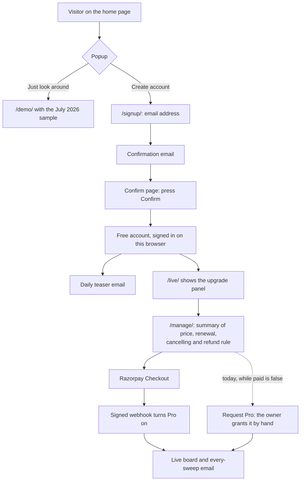

# Design: screens, flows and display rules

> **Stage 3 of 7.** There are no wireframes, because every screen below is live (or built and switched off). This
> page lists the screens, summarises the user journeys and the rules every Pro page follows, and links the detailed
> designs: [account-flows.md](../../docs/subscriptions/account-flows.md) (the flows as built, with a review),
> [paid-website.md](../../docs/subscriptions/paid-website.md) (who sees what) and
> [homepage-review.md](../../docs/site/homepage-review.md) (the home page audit). State on 2026-10-24.

## Screens

Base address: `https://travel-problem-radar.vercel.app`. GitHub Pages serves the same files but has no `/api/`, so
its copies of the account pages send people to the Vercel copy ([decisions.md](../../docs/decisions.md), 2026-10-22).

| Screen | Who it's for | What it does | Status |
|---|---|---|---|
| `/` Home | Visitors | Product page: what it finds, how it works, plans, FAQ. A sign-up / sign-in popup on every signed-out visit | Live since 2026-10-22 |
| `/demo/` | Anyone | Replays the saved July 2026 sample, with no AI calls (REQ-07) | Live |
| `/live/` Live board | Pro | Every sweep, history, New flags, Copy report. Others see a sign-in or upgrade panel (REQ-24) | Live; locked since 2026-10-23 |
| `/subscribe/` Plans | Visitors | Free and Pro side by side; "Create your account" leads to `/signup/` | Live |
| `/signup/` | Visitors | The one sign-up form, with an unticked "I'd also like Pro" box | Live |
| `/signin/` | Members | Email me a link; Continue with Google once its keys are set | Live; Google hidden |
| Confirm and sign-in pages | Members | Opened from an email link; a button must be pressed, so mail scanners can't confirm or sign anyone in | Live |
| `/manage/` | Members | Plan, categories (Pro), Request Pro, Delete my account; Upgrade and Cancel in a paid build | Live; checkout behind `paid: false` |
| `/pricing/` | Visitors | Price, GST wording, renewal, cancelling and the refund rule, filled from `plan.json` (REQ-29) | Live since 2026-10-23, says Pro is free while tested |
| `/about/` | Visitors, Razorpay's review | Who runs it | Live since 2026-10-23 |
| `/legal/privacy/`, `/legal/contact/`, `/legal/refunds/` | Everyone | Policy pages | Live; not reviewed by a lawyer |
| `/legal/terms/` | Everyone | Terms of use | **Draft, not shipped**: waits for an adviser's liability clause |

Status sources: [decisions.md](../../docs/decisions.md) 2026-10-22 and 2026-10-23;
[progress.md](../../docs/subscriptions/tasks/progress.md).

## Who sees what

| | Visitor | Free account | Pro |
|---|---|---|---|
| Demo with the July 2026 sample | Yes | Yes | Yes |
| Live board, history, Copy report | Sign-in panel | Upgrade panel | Yes |
| Email | No | A daily teaser: counts and headlines for all four categories | The full digest after every saved scheduled sweep |
| Choose categories | No | No | Yes |

The lock is enforced by the data feed (`/api/data`), not by the page. The page's panel is a convenience
([paid-website.md](../../docs/subscriptions/paid-website.md#guardrails)).

## The journey, end to end

The detailed flows, drawn from the code, are in [account-flows.md](../../docs/subscriptions/account-flows.md):
create an account, sign in again, while signed in, and Continue with Google. This is the whole path from visitor to
paying member. The payment steps are built and passed a test-mode run on staging; they are not live.

Solid lines are the designed path. The dotted line is how Pro is reached today.

## Display rules for anything about Pro

[T23](../../docs/subscriptions/tasks/T23-pro-display-standards.md) sets these rules once, so every page that shows
Pro says the same true things. The legal points in it are summaries from secondary sources and are marked **verify**
there.

| Group | Rules (T23 IDs) | How they're kept true |
|---|---|---|
| Price and billing | Full price wherever Pro is offered (A1); "renews automatically" next to every pay button (A2); cancel as easy as buying (A3); one refund rule everywhere (A4); renewals and pre-debit notice explained (A5); only the payment methods that are on (A6); what happens after paying (A7) and after a failed renewal (A8) | `plan.json` is the one source; `npm run check` fails a page with a ₹ amount and no "renews" |
| Honest content | Free next to Pro (B1); Pro's limits stated, including that no person checks the findings (B2); no invented numbers (B3); no false urgency (B4); no confirm-shaming (B5); no pre-ticked boxes (B6); the same words everywhere (B7) | `npm run check` fails a ticked Pro box and words like "hurry" or "most popular" |
| UI and accessibility | Two-column plans (C1); WCAG 2.2 AA contrast (C2); keyboard and visible focus (C3); 24 px targets (C4); table headers with `scope` (C5); status changes announced (C6); no meaning by colour alone (C7); 360 px wide with no sideways scroll (C8); static pages, no new function (C9) | `npm run check` fails a table without `scope`; contrast, keyboard and phone width are checked by hand in each pull request |

## Design decisions and their trade-offs

| Decision | Why | Trade-off | Source |
|---|---|---|---|
| A button after every email link | Mail scanners open links; only a person presses a button | One more click | [decisions.md](../../docs/decisions.md) D9 |
| No passwords: an emailed link, or Google | Nothing to store, leak or reset | Every way in but Google waits for an email | [account-flows.md](../../docs/subscriptions/account-flows.md#what-is-right-and-should-stay) |
| A sign-in lasts until the browser closes, 12 hours at most | The owner asked that the last login not be remembered | Members sign in more often, and each sign-in is an email | [decisions.md](../../docs/decisions.md) 2026-10-22 |
| A popup on every signed-out visit | The owner asked for it; no further reason is recorded | Google counts covering popups against pages on mobile; returning visitors see it every time | [homepage-review.md](../../docs/site/homepage-review.md#the-popup) |
| A new Google address confirms before an account is made | The owner wanted Google sign-up to go through sign-up steps | One more click for new people | [decisions.md](../../docs/decisions.md) 2026-10-22 |
| The Free teaser shows headlines for all four categories | Matches what the terms already say Free gets | Free readers see what was found, but not the source or the product idea | [decisions.md](../../docs/decisions.md) 2026-10-23 |
| Home page shows no live findings to visitors | Nothing from live sweeps is shown publicly | Visitors see only the July 2026 sample | [decisions.md](../../docs/decisions.md) 2026-10-23 |

## Known design gaps

| Gap | Effect | Next step | Source |
|---|---|---|---|
| Chrome showed a "Dangerous site" warning on the confirm link (2026-10-22) | New visitors may stop at the warning. The cause is unknown | Move to the owner's own domain, then ask Google for a review (parked by the owner) | [account-flows.md](../../docs/subscriptions/account-flows.md#what-should-change) #1; [progress.md](../../docs/subscriptions/tasks/progress.md) |
| Outlook.com files the emails in Junk; Gmail filed the first confirmation as spam | Members may never see the confirm link | The sign-up reply says to check spam; recheck the domain's reputation as it ages | [progress.md](../../docs/subscriptions/tasks/progress.md) |
| Sign-in always lands on `/live/` | People don't return to the page they started from | Remember the starting page | [account-flows.md](../../docs/subscriptions/account-flows.md#what-should-change) #6, Later |
| A link opened on a phone signs in the phone, not the laptop | Sign-in fails across devices | A short code in the sign-in email | #8, Later |
| No Terms link in the footer; no Open Graph image | Razorpay's website review may need terms; shared links show no picture | Ship terms after the liability clause; make an image | [homepage-review.md](../../docs/site/homepage-review.md#still-to-come) |
| No usability test with anyone but the owner | The flows are checked against common practice, not against users | Part of the [interview plan](../01-discovery/discovery-log.md#interview-plan-proposed-not-done) | This page |
