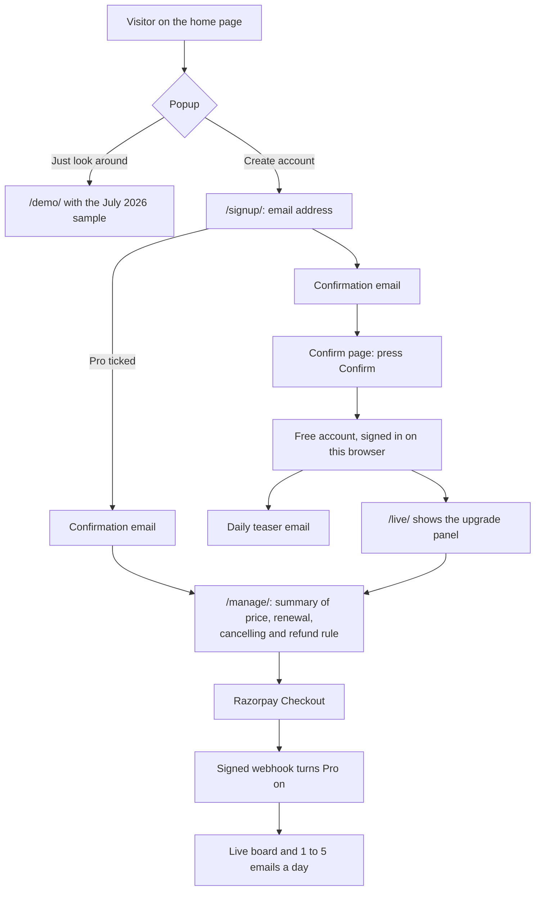

# Design: screens, flows and display rules

> **Stage 3 of 8.** There are no wireframes, because every screen below is live. This
> page lists the screens, summarises the user journeys and the rules every Pro page follows, and links the detailed
> designs: [account-flows.md](../../docs/subscriptions/account-flows.md) (the flows as built, with a review),
> [paid-website.md](../../docs/subscriptions/paid-website.md) (who sees what) and
> [homepage-review.md](../../docs/site/homepage-review.md) (the home page audit). State on 2026-10-31 (first written
> 2026-10-24).

## Screens

Base address: `https://radar.pehchanthetraveller.com` since 2026-10-28; pages on the old
`travel-problem-radar.vercel.app` address redirect there ([CHANGELOG](../../CHANGELOG.md) 2026-10-28). GitHub Pages
serves the same files but has no `/api/`, so its copies of the account pages send people to the live site
([decisions.md](../../docs/decisions.md), 2026-10-22).

Every page takes the Pehchan brand (deep teal and amber), in light or dark to match the visitor's system, from
`brand.css` (2026-10-29; it was dark only). Every page starts with a skip link to its main content (2026-10-30,
BUG-011; it was the home page only).

| Screen | Who it's for | What it does | Status |
|---|---|---|---|
| `/` Home | Visitors | Product page: what it finds, how it works, plans, FAQ. A sign-up / sign-in popup on every signed-out visit | Live since 2026-10-22 |
| `/demo/` | Anyone | Replays the saved July 2026 sample, with no AI calls (REQ-07). A Trends tab opens `/trends/` (T44) | Live |
| `/live/` Live board | Pro | Every sweep, New flags, Copy report. One card per category with its counts; area and category chips; search in this sweep or all saved sweeps; a Details panel with each problem's history; Save, and a fourth tab, Saved; Share; 👍 Useful / 👎 Not useful under each card. An "Ask the board" box above the area tiles, when switched on: a question, an optional category and the questions left today; the answer in plain text with numbered sources and a line saying it was written by AI. A Trends tab opens the public `/trends/` page (T44). Others see a sign-in or upgrade panel (REQ-24) | Live; locked since 2026-10-23; board features 29 to 31 Oct (T36 to T44). Ask is off until `ASK_ENABLED=1` |
| `/p/<sweep>/<item>` Share page | Anyone with the link | One problem: headline, category, severity, source, region and date for everyone; the summary, opportunity and source link for Pro. Not indexed; a preview card with `og.png` | Live 2026-10-30 (T40) |
| `/trends/` Trends | Anyone, a government reader among them | New problems each week and in the last 30 days, by area (India first) and category, as charts with tables; a rising list linking to the live board's filters; how the counts are made. Counts only. `?area=India` opens on India | Live (T44, #141); the counts start with the next scheduled sweep |
| `/subscribe/` Plans | — | Redirects to `/pricing/` since 2026-10-28; the file is kept but no longer reachable | Retired |
| `/signup/` | Visitors | The one sign-up form, with an unticked "I'd also like Pro" box and an optional password. With Pro ticked, confirming goes straight to payment (`/manage/?pay=1`) | Live |
| `/signin/` | Members | Email me a link, email and password, or Continue with Google | Live; Google on (TS09, 2026-10-30) |
| Confirm and sign-in pages | Members | Opened from an email link; a button must be pressed, so mail scanners can't confirm or sign anyone in | Live |
| `/manage/` | Members | The plan card (monthly or yearly, categories, areas, emails a day) and Pay with Razorpay; Keep renewing or Renew Pro; Cancel; Password; Delete my account (cancels Razorpay first) | Live; paying since 2026-10-28 |
| `/pricing/` | Visitors | Price, GST wording, renewal, cancelling and the refund rule, filled from `plan.json` (REQ-29) | Live; ₹1 a month or ₹1 a year since 2026-10-28 (was "free while tested") |
| `/about/` | Visitors, Razorpay's review | Who runs it | Live since 2026-10-23 |
| `/legal/privacy/`, `/legal/contact/`, `/legal/refunds/` | Everyone | Policy pages | Live; not reviewed by a lawyer |
| `/legal/terms/` | Everyone | Terms of use | Live since 2026-10-29 with the owner's plain liability clause; an adviser's check is open (was a draft, not shipped) |
| `/admin/` | The owner | Members, plans, areas, payment mode, behind its own user and password; linked from every footer | Live since 2026-10-26 |

Status sources: [decisions.md](../../docs/decisions.md) 2026-10-22 and 2026-10-23;
[progress.md](../../docs/subscriptions/tasks/progress.md); [CHANGELOG](../../CHANGELOG.md) 2026-10-26 to 2026-10-30.

## Who sees what

| | Visitor | Free account | Pro |
|---|---|---|---|
| Demo with the July 2026 sample | Yes | Yes | Yes |
| Live board, history, Copy report | Sign-in panel | Upgrade panel | Yes |
| Details, areas, search all sweeps, saved problems | On the demo's sample | On the demo's sample | Yes, on the live board |
| Useful / Not useful votes; Ask the board (when on) | No | No | Yes, on the live board |
| Trends: counts by area and category, rising (T44) | Yes | Yes | Yes. A rising row opens the live board, which shows the problems to Pro only |
| A shared problem's page | Headline and facts | Headline and facts | In full |
| Email | No | A daily teaser: counts and headlines for all four categories | 1 to 5 digests a day, as chosen |
| Choose categories and areas | No | No | Yes |

The lock is enforced by the data feed (`/api/data`), not by the page. The page's panel is a convenience
([paid-website.md](../../docs/subscriptions/paid-website.md#guardrails)).

## The journey, end to end

The detailed flows, drawn from the code, are in [account-flows.md](../../docs/subscriptions/account-flows.md):
create an account, sign in again, while signed in, and Continue with Google. This is the whole path from visitor to
paying member. Payments have been live since 2026-10-28 (was: built, test-mode run passed on staging).

This is the path since 2026-10-28. Until then Pro was reached by a dotted line: Request Pro, and the owner granted
it by hand while `paid` was false.

## Display rules for anything about Pro

[T23](../../docs/subscriptions/tasks/T23-pro-display-standards.md) sets these rules once, so every page that shows
Pro says the same true things. The legal points in it are summaries from secondary sources and are marked **verify**
there.

| Group | Rules (T23 IDs) | How they're kept true |
|---|---|---|
| Price and billing | Full price wherever Pro is offered (A1); "renews automatically" next to every pay button (A2); cancel as easy as buying (A3); one refund rule everywhere (A4); renewals and pre-debit notice explained (A5); only the payment methods that are on (A6); what happens after paying (A7) and after a failed renewal (A8) | `plan.json` is the one source; `npm run check` fails a page with a ₹ amount and no "renews" |
| Honest content | Free next to Pro (B1); Pro's limits stated, including that no person checks the findings (B2); no invented numbers (B3); no false urgency (B4); no confirm-shaming (B5); no pre-ticked boxes (B6); the same words everywhere (B7) | `npm run check` fails a ticked Pro box and words like "hurry" or "most popular" |
| UI and accessibility | Two-column plans (C1); WCAG 2.2 AA contrast (C2); keyboard and visible focus (C3); 24 px targets (C4); table headers with `scope` (C5); status changes announced (C6); no meaning by colour alone (C7); 360 px wide with no sideways scroll (C8); static pages, no new function (C9) | `npm run check` fails a table without `scope`; contrast, keyboard and phone width are checked by hand in each pull request |

## Design decisions and their trade-offs

| Decision | Why | Trade-off | Source |
|---|---|---|---|
| A button after every email link | Mail scanners open links; only a person presses a button | One more click | [decisions.md](../../docs/decisions.md) D9 |
| No passwords: an emailed link, or Google. **Revised 2026-10-27:** a password is optional | Was: nothing to store, leak or reset. A password needs no email to sign in | Passwords are stored (scrypt hashes) and rate-limited; one can be set only from its own confirmation link or a signed-in manage page | [account-flows.md](../../docs/subscriptions/account-flows.md#what-is-right-and-should-stay); [CHANGELOG](../../CHANGELOG.md) 2026-10-27 |
| Light or dark from the visitor's system, in the Pehchan colors | The owner's brand, from pehchanthetraveller.com | The self-contained pages hold the colors inline and use system fonts, so `npm run sync:brand` must copy each change | [CHANGELOG](../../CHANGELOG.md) 2026-10-29 |
| The board's history is copied onto each saved item | The board fetches nothing new for the Details panel | Each sweep writes a little more | [progress.md](../../docs/subscriptions/tasks/progress.md), T36 notes |
| A sign-in lasts until the browser closes, 12 hours at most | The owner asked that the last login not be remembered | Members sign in more often, and each sign-in is an email | [decisions.md](../../docs/decisions.md) 2026-10-22 |
| A popup on every signed-out visit | The owner asked for it; no further reason is recorded | Google counts covering popups against pages on mobile; returning visitors see it every time | [homepage-review.md](../../docs/site/homepage-review.md#the-popup) |
| A new Google address confirms before an account is made | The owner wanted Google sign-up to go through sign-up steps | One more click for new people | [decisions.md](../../docs/decisions.md) 2026-10-22 |
| The Free teaser shows headlines for all four categories | Matches what the terms already say Free gets | Free readers see what was found, but not the source or the product idea | [decisions.md](../../docs/decisions.md) 2026-10-23 |
| Home page shows no live findings to visitors | Nothing from live sweeps is shown publicly | Visitors see only the July 2026 sample | [decisions.md](../../docs/decisions.md) 2026-10-23 |

## Known design gaps

| Gap | Effect | Next step | Source |
|---|---|---|---|
| Chrome showed a "Dangerous site" warning on the confirm link (2026-10-22) | New visitors may stop at the warning. The cause is unknown | The site moved to the owner's own domain on 2026-10-28. Whether the warning is gone hasn't been recorded; ask Google for a review if it returns | [account-flows.md](../../docs/subscriptions/account-flows.md#what-should-change) #1; [progress.md](../../docs/subscriptions/tasks/progress.md) |
| Outlook.com files the emails in Junk; Gmail filed the first confirmation as spam | Members may never see the confirm link | The sign-up reply says to check spam; recheck the domain's reputation as it ages | [progress.md](../../docs/subscriptions/tasks/progress.md) |
| Sign-in lands on `/live/` (or `/manage/?pay=1` straight after a Pro sign-up) | People don't return to the page they started from | Remember the starting page | [account-flows.md](../../docs/subscriptions/account-flows.md#what-should-change) #6, Later |
| A link opened on a phone signs in the phone, not the laptop | Sign-in fails across devices | A short code in the sign-in email | #8, Later |
| ~~No Terms link in the footer; no Open Graph image~~ Closed: terms live 2026-10-29, `og.png` added 2026-10-30 (T40) | — | — | [homepage-review.md](../../docs/site/homepage-review.md#still-to-come); [CHANGELOG](../../CHANGELOG.md) |
| One account, the one used to test Razorpay, doesn't see the live board while another does (BUG-002, S1, P1) | Cause unknown; a paying member could be locked out | Compare both records read-only; open in the TS19 log | [TS19](../08-testing/TS19-bug-reporting-and-retesting.md) |
| No usability test with anyone but the owner | The flows are checked against common practice, not against users | Part of the [interview plan](../01-discovery/discovery-log.md#interview-plan-proposed-not-done) | This page |
