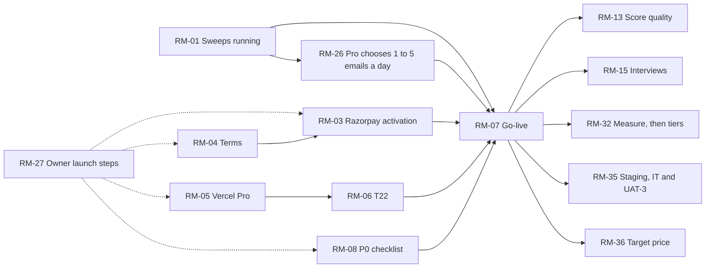

# Roadmap: Now, Next, Later

> **Stage 4 of 8.** What comes after the build recorded in the [backlog](../02-product-definition/backlog.md).
> Updated 2026-10-30 (first written 2026-10-24); task states are from [progress.md](../../docs/subscriptions/tasks/progress.md). Items are grouped by what blocks them, not by date: **target dates are OWNER INPUT NEEDED**, and none
> is promised here. Each item names its source. "Owner" means a step only the owner can take (an account, a payment,
> a legal choice).

## Now: running and going live

| ID | Item | Why | Who | Blocked by | Source |
|---|---|---|---|---|---|
| RM-01 | Get the sweeps running again | **Done** 2026-10-25: the owner put a key with credit in Vercel; a manual sweep at 17:18 UTC saved all four categories (18 items). Every scheduled sweep from 2026-10-23 15:09 UTC until then had failed: "Your credit balance is too low" | Owner: put a key from the owner's own Anthropic account in Vercel, with credit, and redeploy | — | GitHub Actions run logs; I-01 in the [RAID log](raid-log.md) |
| RM-02 | Record why Anthropic refused a call | **Done** 2026-10-24 (PR #79, `1ff7825`): the failure email said only `http 400`; it now gives the error's type and message | Dev | — | [api/_lib/radar.js](../../api/_lib/radar.js) |
| RM-03 | Razorpay live activation | **Done**: live mode since 2026-10-28. Live payments need it | Owner | RM-04 (Razorpay reviews the website) | [payments-razorpay.md](../../docs/subscriptions/payments-razorpay.md#prerequisites) |
| RM-04 | Ship the terms page | **Shipped** 2026-10-29 (#94) with the owner's plain liability draft; the adviser's check is still open. Razorpay's website review; the footer's last missing page | Owner, with an adviser | The liability clause | [decisions.md](../../docs/decisions.md) 2026-10-23 |
| RM-05 | Move to Vercel Pro | Hobby is for non-commercial use; T22 and T27 need it. Still open on 2026-10-30, with live payments since 2026-10-28 (R-08) | Owner | A decision to spend | [costing.md](../../docs/subscriptions/costing.md#risks-and-safeguards) |
| RM-06 | T22: Pro expiry, paid unsubscribe, key safety | A paid Pro must end when payment stops, and a paying member must be able to leave safely. **Built** 2026-10-30: a 48-hour grace for paid Pro due to renew (`PRO_GRACE_HOURS`), the sweep's tidy step, and key safety (live keys only on Production, test keys only on Preview) | Dev | — | [T22](../../docs/subscriptions/tasks/T22-pro-lifecycle-and-go-live.md) |
| RM-07 | T27: test-mode run on a Preview, then go-live | Switches `paid` to `true`. Go-live **done** 2026-10-28; the test-mode run's results aren't recorded | Owner and dev | RM-03 to RM-06 (T27's own list); RM-08 (costing's) | [T27](../../docs/subscriptions/tasks/T27-razorpay-test-run-and-go-live.md) |
| RM-08 | Before the first live payment: Resend Pro, an Anthropic spend limit and alert, the live Razorpay plans | Costing's P0 checklist. The live plans are done (₹1 a month or a year since 2026-10-28; the real price is still to set); Resend Pro and the spend limit are open | Owner | — | [costing.md](../../docs/subscriptions/costing.md#pre-launch-checklist) |
| RM-09 | Answer the open inputs: international cards, a yearly plan, domain renewal | T27 listed cards, the liability clause and a yearly plan as open. The yearly plan was answered 2026-10-26 (CR-17) and the clause 2026-10-29 (CR-18); international cards and domain renewal are still open | Owner | — | [T27](../../docs/subscriptions/tasks/T27-razorpay-test-run-and-go-live.md#before-starting-owner); [T23](../../docs/subscriptions/tasks/T23-pro-display-standards.md) |
| RM-26 | T32: each Pro member chooses 1 to 5 emails a day, and every page says so (replaces T28's fixed 2 a day) | The owner asked for the choice; the site sweeps only as often as members need, so unneeded runs cost nothing. Built and live (#88, #89); the slots were checked on 2026-10-30 from the 26 to 29 Oct runs. Only the owner's check of a test Pro at 3 emails a day is left | Dev | RM-01, for the check after deploy | [T32](../../docs/subscriptions/tasks/T32-sweeps-per-day.md) |
| RM-27 | T30: the owner's launch steps in one order | RM-03, RM-04, RM-05 and RM-08 are owner steps that wait on others; [T30](../../docs/subscriptions/tasks/T30-owner-launch-checklist.md) orders them: terms first, then Razorpay activation, which reviews the website | Owner | — | [T30](../../docs/subscriptions/tasks/T30-owner-launch-checklist.md) |
| RM-29 | T33: one Pro plan, one price whatever categories and emails a day are chosen, paid monthly or yearly (simplified 2026-10-26) | The owner's request (2026-10-25); replaces the single ₹299 monthly price. Includes RM-20's yearly plan. **Live** since go-live, at ₹1 a month or a year (CR-17, CR-18) | Owner (prices), then dev | The target price (R-12) | [T33](../../docs/subscriptions/tasks/T33-pro-plan-builder.md) |
| RM-30 | T34: renewing Pro | A confirmed cancel can't be undone, and a plan whose cycles run out ends without warning. **Live** (#91, #92); Razorpay's `start_at` for a renewal isn't yet verified | Dev | — | [T34](../../docs/subscriptions/tasks/T34-renew-pro.md) |
| RM-31 | T35: sweep slots on time | GitHub starts the scheduled runs hours late; past about 4 h 43 m a run is counted in the wrong slot and a Pro email is missed. **Done**: the 26 to 29 Oct runs were all in the right slot, 228 to 418 minutes late | Dev | — | [T35](../../docs/subscriptions/tasks/T35-sweep-slots-on-time.md) |
| RM-25 | Fix what the 2026-10-24 code audit found | **Done** 2026-10-24 (PRs #81 to #84): 9 bugs and 3 design risks, among them a payment that could leave the payer on Free, and a forwarded digest that could sign the reader in. Still unverified: the real Blob conditional write (until T27) and the artifact's model settings (until a sweep runs inside a Claude artifact) | Dev | — | I-09 in the [RAID log](raid-log.md); [CHANGELOG](../../CHANGELOG.md) 2026-10-24 |

| RM-33 | T36 to T41: the Details panel, areas, search across sweeps, saved problems, share pages, areas in Pro email | **Done** 29 and 30 Oct (#100 to #105), all live | Dev | — | [progress.md](../../docs/subscriptions/tasks/progress.md) |
| RM-34 | BUG-002: one account, the one used to test Razorpay, doesn't see the live board | S1, P1, open (I-10). Needs the two addresses, given in chat only | Owner, then dev | The addresses | [TS19](../08-testing/TS19-bug-reporting-and-retesting.md) |
| RM-35 | Update `staging` to `main`, then run IT-1 to IT-8 and UAT-3 | The first test run (2026-10-30) ended not ready to sign off; these were blocked or not done (R-14, I-11) | Owner (the deploy and the test keys), with Claude Code reading the results | — | [TS07 results](../08-testing/results/TS07-integration-testing-results-2026-10-30.md); [results](../08-testing/results/README.md) |
| RM-36 | Set Pro's target price | ₹1 can't cover about ₹6,797 a month (R-12) | Owner | — | [decisions.md](../../docs/decisions.md) 2026-10-29 |
| RM-37 | Enforce the Content-Security-Policy | It is report-only until checkout shows no violations in the browser console | Owner (the console check), then dev | — | [CHANGELOG](../../CHANGELOG.md) 2026-10-30 |

## Next: checks that are still open

| ID | Item | Why | Source |
|---|---|---|---|
| RM-10 | Check the emailed sign-in link in production | Sign-up is checked there; sign-in isn't | [progress.md](../../docs/subscriptions/tasks/progress.md); REQ-23 |
| RM-11 | Check a real Pro email after choosing categories | T12's last open launch check | [progress.md](../../docs/subscriptions/tasks/progress.md); REQ-21 |
| RM-12 | Check Gmail's one-click unsubscribe in a real inbox | Only tested offline | REQ-13 in the [PRD](../02-product-definition/prd.md) |
| RM-13 | Score 20 or more live items with the draft rubric | No quality goal (G1 to G4) has been measured | [kpis.md](../02-product-definition/kpis.md); [README](../../README.md#how-i-measured-quality) |
| RM-14 | Count sweeps for a week and read a month of real spend | The cost model uses 5 Sonnet runs. 10 Haiku sweeps (26 to 30 Oct) are now logged at $0.1121 average (`node scripts/llm-logs.mjs models`); a month of real spend isn't read | [costing.md](../../docs/subscriptions/costing.md#measurement-checklist) rows 1 to 3 |
| RM-15 | Run the interview plan | No one but the owner has been asked anything | [discovery-log.md](../01-discovery/discovery-log.md#interview-plan-proposed-not-done) |
| RM-16 | Move to the owner's own domain | **Done** 2026-10-28: radar.pehchanthetraveller.com (CR-21). Whether the Chrome warning and the Junk filing improve isn't recorded | [account-flows.md](../../docs/subscriptions/account-flows.md#what-should-change) #1; [CHANGELOG](../../CHANGELOG.md) 2026-10-28 |
| RM-38 | A week after T42 is live, read `llm-logs.mjs areas` and `models`, then decide whether a 5th, India-only call is needed | India's share was 1.1% before T42 (KPI-20). Whether one more search a call lifts it, how good the India items are, and what it costs aren't known (R-15, R-16) | [T42](../../docs/subscriptions/tasks/T42-india-focus.md); [kpis.md](../02-product-definition/kpis.md) |

## Later: only if users ask for it

| ID | Item | Source |
|---|---|---|
| RM-17 | Return to the starting page after sign-in | [account-flows.md](../../docs/subscriptions/account-flows.md#what-should-change) #6 |
| RM-18 | A code in the sign-in email for signing in on another device | account-flows.md #8 |
| RM-19 | "New" tracks events, not headlines | [PRD](../02-product-definition/prd.md#open-questions) open question 3 |
| RM-20 | A yearly plan: **moved into RM-29** (T33) on 2026-10-25 | PRD non-goals: only if paying up front matters |
| RM-21 | Handle Razorpay refund and dispute events automatically | [costing.md](../../docs/subscriptions/costing.md#risks-and-safeguards): manual today |
| RM-22 | An admin command to clear a bounce | [decisions.md](../../docs/decisions.md) 2026-10-23: none yet |
| RM-23 | A cheaper model for the sweep, after a quality comparison: **done**. Haiku is the default since 2026-10-25 (CR-19); the 2026-10-30 model test kept it, with a blind review marked by ChatGPT | DSC-08; [model test](../../docs/subscriptions/model-test-2026-10-30.md) |
| RM-28 | T29: usage per category in each saved sweep (optional): **done** 2026-10-30, in the private LLM logs | [T29](../../docs/subscriptions/tasks/T29-usage-by-category.md); needed if Plus or Starter is priced by category |
| RM-32 | T31: measure the first 20 to 30 paying members, then decide on Plus and Starter (numbered RM-29 until 2026-10-30, which T33 also used) | [T31](../../docs/subscriptions/tasks/T31-measure-and-add-tiers.md) |
| RM-24 | An Open Graph image: **done** 2026-10-30, `og.png` (T40) | [homepage-review.md](../../docs/site/homepage-review.md#still-to-come) |

## Order

pricing.md's rule not to charge before a real sweep is scored ([decisions.md](../../docs/decisions.md), 2026-10-22)
would put RM-13 before RM-07. The order above follows T27's prerequisites and costing's P0 checklist, neither of
which includes scoring; which comes first is the owner's call. Go-live (RM-07) happened on 2026-10-28 with RM-05,
RM-08's Resend Pro and spend limit, and RM-13 still open.
