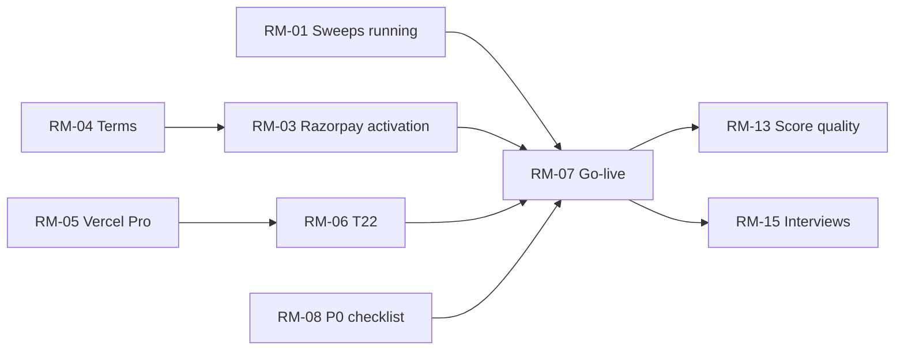

# Roadmap: Now, Next, Later

> **Stage 4 of 7.** What comes after the build recorded in the [backlog](../02-product-definition/backlog.md), on
> 2026-10-24. Items are grouped by what blocks them, not by date: **target dates are OWNER INPUT NEEDED**, and none
> is promised here. Each item names its source. "Owner" means a step only the owner can take (an account, a payment,
> a legal choice).

## Now: running and going live

| ID | Item | Why | Who | Blocked by | Source |
|---|---|---|---|---|---|
| RM-01 | Get the sweeps running again | Every scheduled sweep since 2026-10-23 15:09 UTC failed: Anthropic refused all four categories with HTTP 400, and nothing was saved | Owner: put a key from the owner's own Anthropic account in Vercel, with credit, and redeploy | — | GitHub Actions run logs; I-01 in the [RAID log](raid-log.md) |
| RM-02 | Record why Anthropic refused a call | **Done** 2026-10-24 (PR #79, `1ff7825`): the failure email said only `http 400`; it now gives the error's type and message | Dev | — | [api/_lib/radar.js](../../api/_lib/radar.js) |
| RM-03 | Razorpay live activation | Live payments need it | Owner | RM-04 (Razorpay reviews the website) | [payments-razorpay.md](../../docs/subscriptions/payments-razorpay.md#prerequisites) |
| RM-04 | Ship the terms page | Razorpay's website review; the footer's last missing page | Owner, with an adviser | The liability clause | [decisions.md](../../docs/decisions.md) 2026-10-23 |
| RM-05 | Move to Vercel Pro | Hobby is for non-commercial use; T22 and T27 need it | Owner | A decision to spend | [costing.md](../../docs/subscriptions/costing.md#risks-and-safeguards) |
| RM-06 | T22: Pro expiry, paid unsubscribe, key safety | A paid Pro must end when payment stops, and a paying member must be able to leave safely | Dev | RM-05 | [T22](../../docs/subscriptions/tasks/T22-pro-lifecycle-and-go-live.md) |
| RM-07 | T27: test-mode run on a Preview, then go-live | Switches `paid` to `true` | Owner and dev | RM-03 to RM-06 (T27's own list); RM-08 (costing's) | [T27](../../docs/subscriptions/tasks/T27-razorpay-test-run-and-go-live.md) |
| RM-08 | Before the first live payment: Resend Pro, an Anthropic spend limit and alert, a live Razorpay plan at ₹299 | Costing's P0 checklist | Owner | — | [costing.md](../../docs/subscriptions/costing.md#pre-launch-checklist) |
| RM-09 | Answer the open inputs: international cards, a yearly plan, domain renewal | T27 lists cards, the liability clause and a yearly plan as still open; they change what `/pricing/` and the payment methods say | Owner | — | [T27](../../docs/subscriptions/tasks/T27-razorpay-test-run-and-go-live.md#before-starting-owner); [T23](../../docs/subscriptions/tasks/T23-pro-display-standards.md) |
| RM-25 | Fix what the 2026-10-24 code audit found | **Done** 2026-10-24 (PRs #81 to #84): 9 bugs and 3 design risks, among them a payment that could leave the payer on Free, and a forwarded digest that could sign the reader in. Still unverified: the real Blob conditional write (until T27) and the artifact's model settings (until a sweep runs inside a Claude artifact) | Dev | — | I-09 in the [RAID log](raid-log.md); [CHANGELOG](../../CHANGELOG.md) 2026-10-24 |

## Next: checks that are still open

| ID | Item | Why | Source |
|---|---|---|---|
| RM-10 | Check the emailed sign-in link in production | Sign-up is checked there; sign-in isn't | [progress.md](../../docs/subscriptions/tasks/progress.md); REQ-23 |
| RM-11 | Check a real Pro email after choosing categories | T12's last open launch check | [progress.md](../../docs/subscriptions/tasks/progress.md); REQ-21 |
| RM-12 | Check Gmail's one-click unsubscribe in a real inbox | Only tested offline | REQ-13 in the [PRD](../02-product-definition/prd.md) |
| RM-13 | Score 20 or more live items with the draft rubric | No quality goal (G1 to G4) has been measured | [kpis.md](../02-product-definition/kpis.md); [README](../../README.md#how-i-measured-quality) |
| RM-14 | Count sweeps for a week and read a month of real spend | The cost model uses 5 runs | [costing.md](../../docs/subscriptions/costing.md#measurement-checklist) rows 1 to 3 |
| RM-15 | Run the interview plan | No one but the owner has been asked anything | [discovery-log.md](../01-discovery/discovery-log.md#interview-plan-proposed-not-done) |
| RM-16 | Move to the owner's own domain | The Chrome warning, and perhaps where emails land | [account-flows.md](../../docs/subscriptions/account-flows.md#what-should-change) #1 (parked by the owner) |

## Later: only if users ask for it

| ID | Item | Source |
|---|---|---|
| RM-17 | Return to the starting page after sign-in | [account-flows.md](../../docs/subscriptions/account-flows.md#what-should-change) #6 |
| RM-18 | A code in the sign-in email for signing in on another device | account-flows.md #8 |
| RM-19 | "New" tracks events, not headlines | [PRD](../02-product-definition/prd.md#open-questions) open question 3 |
| RM-20 | A yearly plan | PRD non-goals: only if paying up front matters |
| RM-21 | Handle Razorpay refund and dispute events automatically | [costing.md](../../docs/subscriptions/costing.md#risks-and-safeguards): manual today |
| RM-22 | An admin command to clear a bounce | [decisions.md](../../docs/decisions.md) 2026-10-23: none yet |
| RM-23 | A cheaper model for the sweep, after a quality comparison | DSC-08; [haiku-test.md](../../docs/subscriptions/haiku-test.md) (estimated, not run) |
| RM-24 | An Open Graph image | [homepage-review.md](../../docs/site/homepage-review.md#still-to-come) |

## Order

pricing.md's rule not to charge before a real sweep is scored ([decisions.md](../../docs/decisions.md), 2026-10-22)
would put RM-13 before RM-07. The order above follows T27's prerequisites and costing's P0 checklist, neither of
which includes scoring; which comes first is the owner's call.
