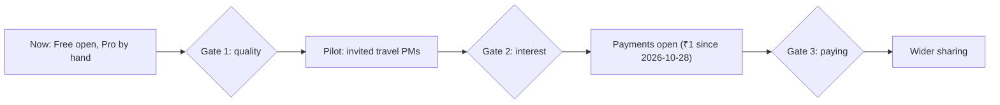

# Go-to-market plan

> **Stage 5 of 8. Proposed, not done.** None of the channels or gates on this page has been run. No one besides the owner is recorded as a
> user, so the segments are hypotheses, the channels are ones the owner already has, and every threshold is
> **OWNER INPUT NEEDED**. The page follows T23's rules for honest content: no member counts, testimonials, ratings
> or urgency without a source ([T23](../../docs/subscriptions/tasks/T23-pro-display-standards.md) B3, B4).
> Written 2026-10-24. Updated 2026-10-30: payments opened on 2026-10-28 at ₹1 a month or a year, before the
> gates below (see "Where the stages stand"); PMs at Indian travel companies are the first segment to test (T42). Updated 2026-10-31: Indian
> communities to try, and a later path to the Government of India (RM-39, RM-40).

## Who it's for

| Segment | Evidence | Status | Source |
|---|---|---|---|
| **The owner**, a PM scouting for travel problems | Uses it; reported the Slack digest on 1 Aug 2026 | The only user recorded | [PRD](../02-product-definition/prd.md#users) |
| **PMs at Indian travel companies** (online travel agencies, airlines, rail, travel fintech and payments) | None. The owner chose them on 2026-10-30, with India items in every sweep (T42) | **Hypothesis**: the first segment to test | DSC-09; DSC-01, DSC-05, DSC-06 in the [discovery log](../01-discovery/discovery-log.md#assumptions-and-their-evidence) |
| **PMs working in travel elsewhere** (airlines, OTAs, hotels, travel tech) | None | **Hypothesis**: next, with the worldwide items | DSC-01, DSC-05, DSC-06 |
| **Government of India and state tourism departments** | None. The owner: "I want to take this till govt of india" (2026-10-31) | **Hypothesis**: later, once India items are shown to be good (RM-38), through a monthly India report (RM-39, RM-40) | DSC-10 |
| Founders and solo PMs looking for a problem to build on | None | Hypothesis | [pricing.md](../../docs/subscriptions/pricing.md#open-questions-owner-input-needed) open question 1 |
| Recruiters and hiring managers reading the portfolio | Named in the v1 PRD | Readers of the demo and this case study, **not** buyers of Pro | [PRD](../02-product-definition/prd.md#users) |

Which segment pays, and how much, is the first thing the [interview plan](../01-discovery/discovery-log.md#interview-plan-proposed-not-done)
asks (RM-15). Until then the plan targets travel PMs only, starting with those in India; the Government of India comes later (RM-40). Prices stay in ₹, as
they are today (₹1 a month or a year since 2026-10-28).

## Positioning

Built from the live home page's own words, and from the differences in
[alternatives.md](../01-discovery/alternatives.md#where-the-radar-differs-claims-to-test-not-findings), which are
**claims to test, not findings**:

> For product managers looking for travel problems worth solving, Travel Problem Radar is a feed of recent problems
> in travel, found on the web about 5 times a day. Each one comes with its source and a product idea that could
> solve it. Unlike keyword alerts (ALT-01) or a scheduled AI prompt (ALT-07), it needs no keyword list, covers four
> kinds of problem in one feed, and flags what's new.

| Message | Wording on the live site | Proof available |
|---|---|---|
| What it is | "Travel-industry problems, found for you." | The public demo replays a saved July 2026 sample |
| Why it's different | "Each one comes with its source and a product idea that could solve it." | Every item has a source link (REQ-10). Whether the ideas are useful is **Not measured** (KPI-04) |
| How fresh | "Updated about 5 times a day" | The schedule in `sweep.yml`. A week's count is **Not measured** (KPI-08) |
| The limit, stated plainly | "The items are gathered by an AI model with web search and are not verified." | T23 B2 requires it |
| Free to start | "Free. No password: your email address is your account." | Live sign-up |

Source for the wording: [the home page](../../index.html).

**Not to be said** until there is a source: how many members there are, how accurate the findings are, time saved,
or that it beats any alternative. No sweep has been scored (R-01). Nor that it covers India well, until KPI-20 is
read on or after 2026-11-06, a week after T42 went live (RM-38).

## Channels

Only channels the owner already has. **Effort, cost and timing are OWNER INPUT NEEDED**; no paid channel is planned
and no marketing budget is recorded ([costing.md](../../docs/subscriptions/costing.md#business-costs-not-included)).

| Channel | Already exists | What it would carry | Measured by |
|---|---|---|---|
| The product's home page and public demo | Yes | Sign-up; the sample | KPI-10 sign-ups |
| The owner's portfolio site | Yes; the GitHub Pages copy links back to it | The case study and the demo | KPI-10 |
| This GitHub repository | Yes, public | The case study, for PMs and hiring readers | Not tracked |
| The owner's LinkedIn profile | Linked from `/about/` | Posts about what the radar finds, each linking its source | KPI-10, by day of the post |
| The Free teaser email | Yes | The daily headlines; the reason to upgrade | KPI-13 Pro requests; KPI-17 after payments open |
| Direct invitations to travel PMs | No list exists | The pilot below; the interview plan | KPI-10, KPI-11, interviews |
| Communities and groups of Indian travel PMs | To try. **Checked 2026-10-31** against the source linked: [The Product Folks](https://communityplaybooks.substack.com/p/the-product-folks-suhas-motwani), a volunteer-led community of Indian PMs with Slack, events and a job board; [iSPIRT](https://ispirt.in/who-we-are/), a non-profit think tank since 2013, known for India Stack; [FAITH](https://iato.in/circulars/view/1887), the federation of 10 travel and hospitality associations, among them TAAI, IATO and ADTOI; the [SATTE](https://www.jetro.go.jp/en/database/j-messe/tradefair/detail/157241) trade show in New Delhi, next listed for 19–21 Jan 2027; [OTM](https://maharashtratourism.gov.in/otm-mumbai-2026/) in Mumbai, held 5–7 Feb 2026, 2027 dates not found. **To verify**: the India Product Management Association (IPMA) and the [Institute of Product Leadership](https://www.productleadership.com/about-ipl/)'s Product Leaders Forum; NASSCOM; OTOAI (its full name differs between sources); member counts. Pragmatic Leaders, listed before, is a paid PM course company, not a community ([Inc42](https://inc42.com/buzz/pragmatic-leaders-product-manager/)). Also PMs at Indian online travel agencies, airlines, rail and payments companies on LinkedIn. The owner is in none of them (said 2026-10-31), so each one starts from joining and taking part before posting about the radar | Posts about India items, each linking its source; the interview plan's India segment | KPI-10, interviews |

No page-analytics script is in the site's code, so visits aren't counted; sign-ups are the first measured step
([data-and-metrics.md](../07-data-and-metrics/data-and-metrics.md#what-isnt-measured)).

## Rollout, with gates

Each step opens only when its gate passes. The gates reuse
[pricing.md](../../docs/subscriptions/pricing.md#rollout-order-with-gates)'s order; the thresholds are to be set by
the owner **before** looking at the results, as pricing.md asks.



| Step | What happens | Gate to the next step | KPIs | Threshold |
|---|---|---|---|---|
| **Now** (as written 2026-10-24) | Free sign-up open; Pro given by hand; sweeps failing since 2026-10-23 (I-01, closed 2026-10-25) | **Gate 1:** sweeps running again (RM-01), and 20 or more live items scored (RM-13) | KPI-01 to KPI-03, KPI-09 | **OWNER INPUT NEEDED** |
| **Pilot** | Invite a small group of travel PMs, given Pro by hand; run the interview plan with some of them | **Gate 2:** enough of them confirm, keep reading and say they'd pay | KPI-10, KPI-11, KPI-12, KPI-13, KPI-15; interview answers | **OWNER INPUT NEEDED**: group size, period, pass marks |
| **Payments open** | Go-live from the [launch plan](launch-plan.md) | **Gate 3:** paying members, retention and refunds hold for a month | KPI-16 to KPI-19 | Break-even was 24 to 28 at ₹299; at ₹1 no number of members covers the cost, so the target price comes first. The rest **OWNER INPUT NEEDED** |
| **Wider sharing** | The channels above, more often | — | KPI-10, KPI-17 | — |

Gate 1 is pricing.md's rule not to charge before a real sweep is scored. The owner skipped the original Phase 1 gate
(CR-03), so this plan puts a gate back in front of payments; whether to keep it is a decision in the
[executive review](../06-executive-communication/executive-review.md#decisions-for-the-owner).

### Where the stages stand on 2026-10-30

Payments opened on 2026-10-28, at ₹1 a month or ₹1 a year, without Gate 1 or Gate 2: no live items have been scored
by a person and no pilot group was invited ([launch plan](launch-plan.md); R-01). Sweeps run again since
2026-10-25. Razorpay had captured 3 live ₹1 payments by 2026-10-29; who paid isn't recorded here, and none is
recorded as coming from a channel above. Whether to run the pilot and the gates now, at ₹1, is the owner's call.

## The first 24 to 28 paying members

Break-even at ₹299 is 24 to 28 members ([business case](business-case.md#break-even)); this section is the method for
whatever price the owner sets (R-12), since at ₹1 there is no break-even. How many sign-ups that takes
depends on numbers nobody has yet:

```
Free members needed  = paying members needed ÷ Free-to-paid conversion   (KPI-17, Not measured)
```

So this page sets no sign-up target. After the first month of payments, KPI-17 gives the conversion, and the
formula gives the Free members needed. Until then the plan is the pilot: learn whether travel PMs value the findings
before counting on them to pay.

## The path to the Government of India (proposed, not done)

The owner: "I want to take this till govt of india" (2026-10-31). A ministry wants something different from a PM: what goes wrong for travellers in India, with evidence,
rather than a product opportunity (DSC-10). So this is a second audience, served from the same sweeps.

1. **Show the India items are good** (RM-38): read KPI-20 on or after 2026-11-06 against its 20% target, score India
   items by hand, and add the India-only call if the share is low.
2. **A free, public, monthly India report** (RM-39): the top problems by category, each linking its source. Indian
   public sources to search: DGCA's monthly air passenger complaint data, AirSewa (ALT-08), the National Consumer
   Helpline, data.gov.in, and Railways and IRCTC notices. **To verify** what each publishes.
3. **Take it to government** (RM-40), easiest first. Every entry point is **to verify**, and none has been contacted:

| Entry point | Who | Why it fits |
|---|---|---|
| State tourism departments | Kerala, Rajasthan, Goa and others | Smaller, quicker to decide, and they run pilots |
| Ministry of Tourism | Incredible India; NIDHI, its national database of hotels and other stays | Visitor experience is its brief |
| Ministry of Civil Aviation | AirSewa, Digi Yatra, UDAN | Aviation items line up with its complaint data |
| Railways | IRCTC; CRIS, Railways' IT arm | Many traveller problems |
| Formal routes | DPIIT's Startup India recognition; Smart India Hackathon, where ministries post problem statements; GeM, the Government e-Marketplace | The official ways in, and the way government buys |

Before step 3: a check of India's data law (the Digital Personal Data Protection Act, 2023) for subscriber data
(the checklist for an adviser: [dpdp-check.md](../../docs/subscriptions/dpdp-check.md)), and
the R-15 safeguards, because a wrong item costs more here (R-17). Nothing is to be claimed to an official that KPI-20
and the scored items don't show.

## What could block it

| Blocker | Effect on go-to-market | ID |
|---|---|---|
| Sweeps failing (2026-10-23 to 2026-10-25; I-01 closed, sweeps run again) | Nothing new to show or send while it lasts | I-01, RM-01 |
| Emails land in Junk at Outlook.com | New members miss the confirm link and the teaser | I-03, R-05 |
| Chrome's "Dangerous site" warning on the confirm link | New visitors may stop there | I-04, RM-16 |
| The sign-up popup on every signed-out visit | Google counts covering popups against pages on mobile | CR-09 |
| No findings scored | No proof for the main claim | R-01, RM-13 |
