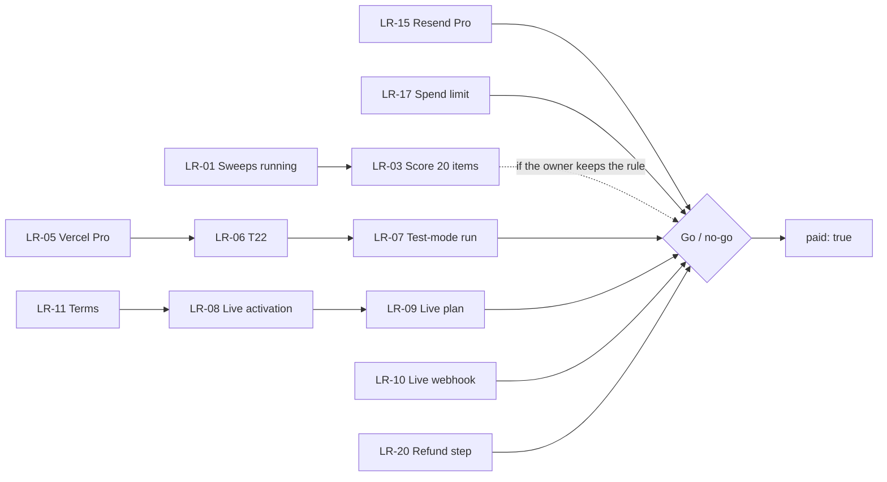

# Launch plan: opening payments

> **Stage 5 of 7.** "Launch" here means **taking real payments for Pro**. The free product is already live. This page
> gathers what must be true first from [T27](../../docs/subscriptions/tasks/T27-razorpay-test-run-and-go-live.md),
> costing's [P0 checklist](../../docs/subscriptions/costing.md#pre-launch-checklist),
> [payments-razorpay.md](../../docs/subscriptions/payments-razorpay.md#prerequisites) and the
> [roadmap](../04-planning-and-governance/roadmap.md), and gives each item an `LR-` ID. **Target dates are OWNER INPUT
> NEEDED.** State on 2026-10-24: not launched.

## Launch readiness checklist

"Blocks" names what can't happen until the item is done. "Owner" means a step only the owner can take.

### Product

| ID | Item | Who | Status | Blocks | Links |
|---|---|---|---|---|---|
| LR-01 | Sweeps run again and save all four categories | Owner: a key with credit in Vercel Production | **Open**: failing since 2026-10-23 15:09 UTC | Go-live: there is nothing new to sell | RM-01, I-01 |
| LR-02 | The failure notice records Anthropic's reason, not just `http 400` | Dev | **Done** (2026-10-24, PR #79) | Nothing; it speeds up LR-01 | RM-02, I-02 |
| LR-03 | 20 or more live items scored with the draft rubric | Owner | Open | Go-live, **if** the owner keeps pricing.md's rule not to charge first | RM-13, R-01, KPI-01 to KPI-05 |
| LR-04 | Production checks still open: emailed sign-in link, a Pro email after choosing categories, Gmail's one-click unsubscribe | Owner | Open | Nothing hard; each is a path a paying member uses | RM-10, RM-11, RM-12 |

### Payments

| ID | Item | Who | Status | Blocks | Links |
|---|---|---|---|---|---|
| LR-05 | Move to Vercel Pro | Owner | Open: a decision to spend | LR-06; go-live (Hobby is non-commercial, **verify** the terms) | RM-05, R-08 |
| LR-06 | T22 built: Pro expiry with a grace period, unsubscribing on paid Pro, key safety | Dev | To do | LR-07 | RM-06, [T22](../../docs/subscriptions/tasks/T22-pro-lifecycle-and-go-live.md) |
| LR-07 | Test-mode run on a Preview: every row of T27's table passes, with the date in the pull request | Owner and dev | To do | Go-live | RM-07 |
| LR-08 | Razorpay live activation, which includes a review of the website | Owner | To do | LR-09, LR-10 | RM-03, D-05 |
| LR-09 | A live Razorpay plan at ₹299, in `RAZORPAY_PLAN_ID` on Production; `check-plan.mjs` matches with the live keys | Owner | To do | Merging `paid: true` | T27 go-live steps 2–3 |
| LR-10 | The live webhook Enabled, with a new `RAZORPAY_WEBHOOK_SECRET` on Production only | Owner | To do | Go-live: without it a paid account stays Free | R-06 |

### Legal and tax

| ID | Item | Who | Status | Blocks | Links |
|---|---|---|---|---|---|
| LR-11 | The terms page, with an adviser's liability clause | Owner, with an adviser | Open | LR-08, if Razorpay requires terms (**verify**) | RM-04, I-05, R-10 |
| LR-12 | Privacy, Contact, Refunds and Pricing pages live | — | **Done** (2026-10-22 and 2026-10-23), not reviewed by a lawyer | — | [decisions.md](../../docs/decisions.md); R-10 |
| LR-13 | The GST case confirmed by a CA. Today: not registered, so no GST is charged | Owner, with a CA | Open: the owner answered; no CA is engaged | P0: "the GST question answered by a CA" | CR-13, D-08 |
| LR-14 | The open inputs: international cards, a yearly plan | Owner | Open | What `/pricing/` and the payment methods say | RM-09 |

### Email

| ID | Item | Who | Status | Blocks | Links |
|---|---|---|---|---|---|
| LR-15 | Resend Pro | Owner | Open | The first live payment (P0) | RM-08, R-04 |
| LR-16 | Inbox placement rechecked at Gmail and Outlook.com | Owner | Open: Outlook.com files the emails in Junk | Nothing hard | I-03, KPI-15 |

### Cost safeguards

| ID | Item | Who | Status | Blocks | Links |
|---|---|---|---|---|---|
| LR-17 | An Anthropic monthly spend limit and alert. DEPLOYMENT.md suggests about $50 a month | Owner | **Not verified** | The first live payment (P0) | RM-08, R-02 |
| LR-18 | Production built from code that includes PR #60, the cap of 3 manual sweeps a day | — | Done: merged as `ff71352`; the Production redeploys on 2026-10-23 were built from code that includes it | — | [costing.md](../../docs/subscriptions/costing.md#stress-tests) |
| LR-19 | The values of `MAX_SUBSCRIBERS` and `MAX_CONFIRMS_PER_DAY` read in Vercel; only their names were checked | Owner | Open | The first live payment (P0) | [costing.md](../../docs/subscriptions/costing.md#pre-launch-checklist) |

### Operations

| ID | Item | Who | Status | Blocks | Links |
|---|---|---|---|---|---|
| LR-20 | A written manual step for refunds and chargebacks: refund in Razorpay, then revoke Pro with the admin script, telling a first payment from a renewal | Owner, with the dev | Open | The first live payment (P0) | R-07, [refund rule](../../docs/decisions.md) 2026-10-23 |
| LR-21 | A weekly check: Razorpay's active subscriptions against Pro records | Owner | Planned for the first month (P1) | — | R-06 |
| LR-22 | Docs after go-live: DEPLOYMENT.md, pricing.md, decisions.md, CHANGELOG.md | Dev | To do | T27's acceptance | [T27](../../docs/subscriptions/tasks/T27-razorpay-test-run-and-go-live.md#acceptance-criteria) |

## Order

## Go / no-go

**Go** when every item that blocks go-live or the first live payment is done: LR-01, LR-05 to LR-10, LR-13, LR-15,
LR-17, LR-19, LR-20, and LR-11 if Razorpay requires terms. LR-03 is in the list only if the owner keeps the rule
not to charge before a scored sweep: that is a decision in the
[executive review](../06-executive-communication/executive-review.md#decisions-for-the-owner).

**No-go** if any of these is open, or if sweeps have failed in the days before, or if the test-mode run found a
failure that isn't fixed. The owner decides and records it in [decisions.md](../../docs/decisions.md).

## Test-mode run

On a branch with `paid: true`, a Preview with the test keys and a test plan at the real price. T27 lists 11 checks:
the price is the same on every page and in Razorpay's screen; payment turns the account Pro within a minute or two;
renewal, a failed renewal, cancelling, paying again and unsubscribing each behave as written; a replayed webhook
changes nothing; and the pricing page and checkout work by keyboard, at phone width and with a screen reader.
Full table: [T27](../../docs/subscriptions/tasks/T27-razorpay-test-run-and-go-live.md#test-mode-run-preview-test-keys).

An earlier test checkout and webhook passed on `staging` on 2026-10-23 (T20, T21), before the pricing and policy
pages existed ([progress.md](../../docs/subscriptions/tasks/progress.md)).

## Go-live steps

From [T27](../../docs/subscriptions/tasks/T27-razorpay-test-run-and-go-live.md#go-live-owner), all the owner's:

1. Live activation approved.
2. The live plan and the live keys, for **Production only**. Keys never go into chat, issues or commits.
3. `check-plan.mjs` matches with the live keys.
4. Merge `paid: true`; redeploy Production.
5. One real payment with the owner's own card, checked on the page, in Razorpay, on `/manage/`, in the webhook log
   and in the receipt. Refund it if wanted.
6. Update pricing.md, the README's "What's next" and progress.md.
7. Announce, through the channels in the [go-to-market plan](go-to-market.md#channels). What the announcement says
   and to whom is **OWNER INPUT NEEDED**.

## Rollback

From [T27](../../docs/subscriptions/tasks/T27-razorpay-test-run-and-go-live.md#roll-back):

- **Stop new payments:** set `paid: false` and redeploy, so the pages go back to the free-test text; unset
  `RAZORPAY_KEY_ID`, so the Upgrade button disappears.
- Paying members keep Pro until their period ends. Cancel their subscriptions in Razorpay if billing must stop.
- Keep `RAZORPAY_WEBHOOK_SECRET` set until the last paid period ends.

When to roll back is in the [post-launch plan](post-launch-plan.md#incident-playbooks).
